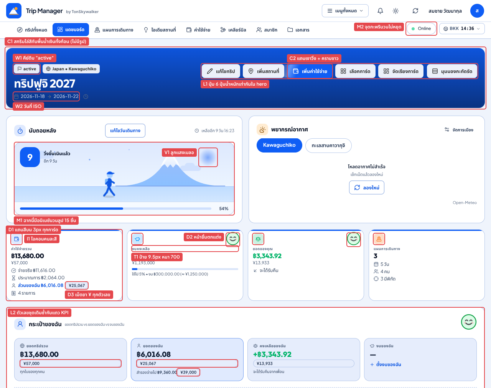
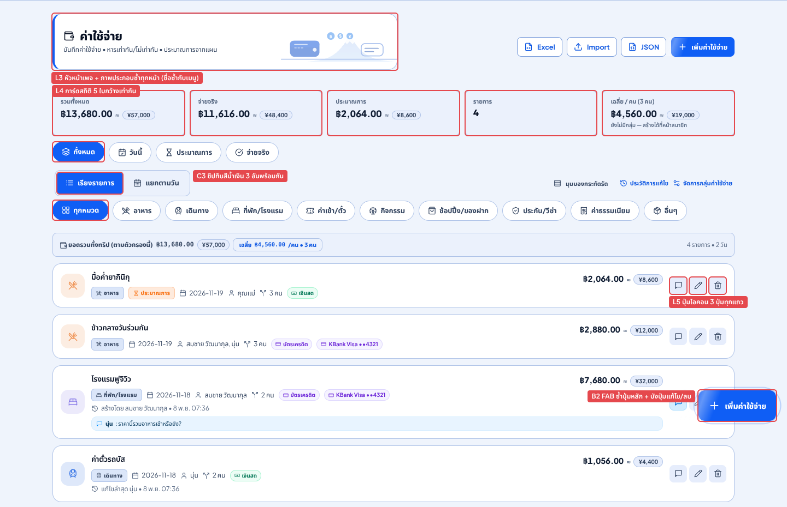
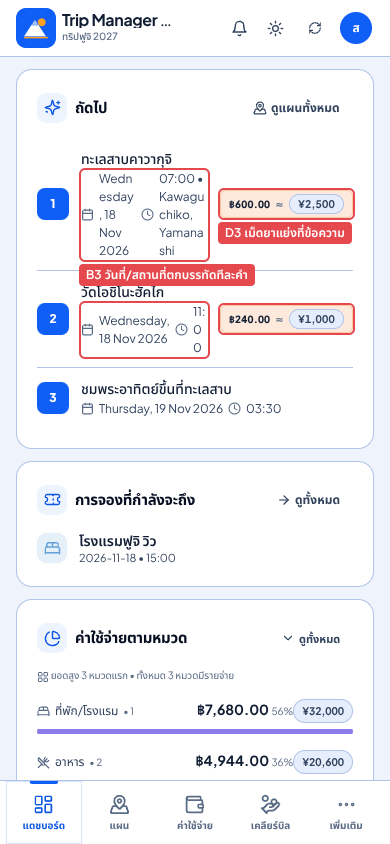
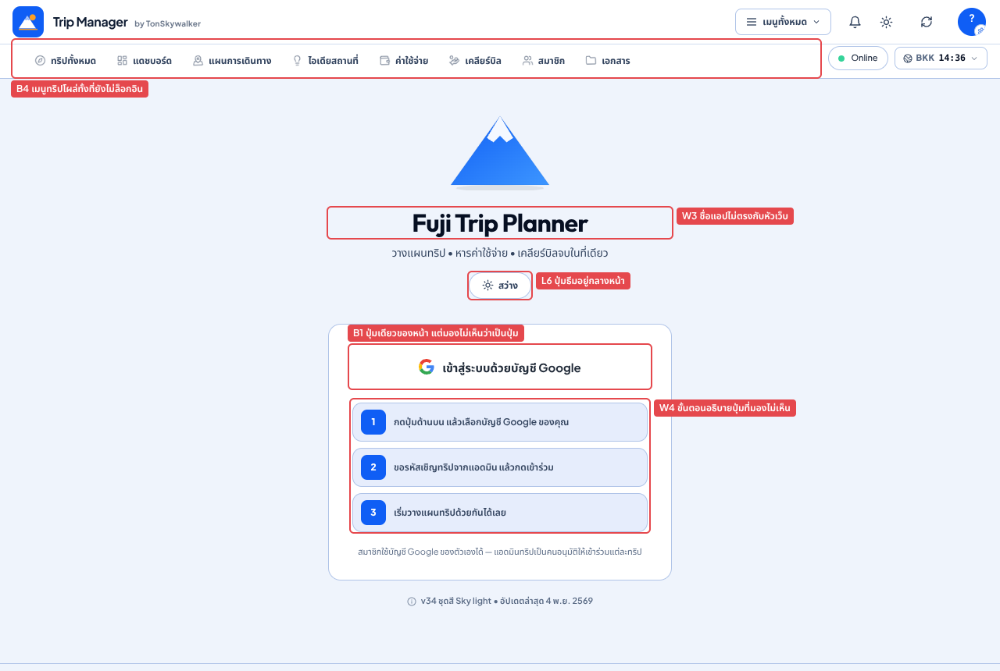

# ตรวจดีไซน์ตามแนวทาง unslop — Trip Manager v34

> ตรวจเมื่อ 8 พ.ย. 2026 · โค้ดที่ commit `03f8f5b` (v34 "flat redesign") · ภาษาไทย โหมดสว่างเป็นหลัก + โหมดมืด 3 หน้า
> วิธีตรวจดัดแปลงจาก **[unslop](https://github.com/heydamir/unslop)** ของ Damir Sokolovsky ([@heydamir](https://github.com/heydamir)) — สัญญาอนุญาต CC BY 4.0
> เอกสารนี้เขียนเป็น **การวิเคราะห์และข้อเสนอแนะ** ก่อนแก้โค้ด
> **อัปเดต 8 พ.ย. 2569:** แก้ครบทั้ง P0–P3 แล้วในเวอร์ชัน v35 ดูสิ่งที่ทำ สิ่งที่ต่างจากข้อเสนอ และงานที่ยังเหลือได้ที่ [ข้อ 9 สถานะการแก้ไข (v35)](#9-สถานะการแก้ไข-v35)

---

## สรุปสั้น

**ระดับ: หนัก (heavy) ตามเกณฑ์ของ unslop** — เจอสัญญาณครบทั้ง 4 หมวดหลัก (สี ตัวอักษร ไอคอน ข้อความ) และหนักที่สุดในหมวดการเคลื่อนไหว
แต่ **โครงไม่ได้แย่**: ข้อมูลครบ ลำดับหน้าเข้าใจง่าย ฟีเจอร์คิดมาดี (หารสองสกุลเงิน การจอง ใบเสร็จรายคน) → แนะนำให้ **ทำครบ 9 รอบโดยไม่รื้อโครง** คือเปลี่ยนชั้นภาพ แต่เก็บข้อมูล ฟีเจอร์ และเส้นทางผู้ใช้ไว้ตามเดิม

**ปัญหาใหญ่ 5 ข้อ**

1. **ขยับตลอดเวลา** — หน้าแดชบอร์ดมีอนิเมชันวนไม่หยุด **28 ตัวพร้อมกัน** (วัดจาก DOM จริง) ทั้งที่เอกสาร v34 ตั้งใจว่า "ไม่มีอนิเมชันวนลูป" แถมการ์ดเริ่มที่ `opacity: 0` แล้วค่อยโผล่ตอนเลื่อนถึง ซึ่งกินแบตตอนเปิดแอปค้างระหว่างเที่ยว และทำให้หน้าว่างตอนพิมพ์หรือแคปหน้าจอยาว
2. **น้ำเงินทุกที่ เลยไม่มีอะไรเด่น** — พื้นหน้า กรอบการ์ด ชิปที่เลือก แถบบนการ์ด และกล่องไอคอนล้วนอมน้ำเงิน แถมยังมี gradient หลงเหลือ (สกริมบน hero, แถบเงาวิ่งบนปุ่มหลัก, ธีมสำเร็จรูป 14 แบบ)
3. **ตัวอักษรตะโกน** — ใช้ 3 ฟอนต์ 29 ขนาด มี `font-weight: 800` อยู่ 108 จุด และป้ายบนการ์ดสถิติเหลือแค่ 9.5px ตัวหนา ภาษาไทยที่มีสระบน-ล่างจึงอ่านยากมาก
4. **ทุกอย่างอยู่ในกล่อง** — ¥ เป็นเม็ดยาทุกตัวเลข ไอคอนอยู่ในกล่องสีทุกหัวข้อ มีการ์ดซ้อนการ์ด ปุ่มน้ำหนักเท่ากัน 6–8 ปุ่มต่อแถว และตัวเลขชุดเดียวกันโชว์ซ้ำ 2 ที่บนแดชบอร์ด
5. **ข้อความหลุด** — มีคีย์ภาษาอังกฤษดิบ (`active`, `trip_admin`, `member`, `temple`) วันที่มี 4 รูปแบบขึ้นไป (วันภาษาไทยกลายเป็น "Wednesday" เพราะไม่ได้โหลด locale) แอปมี 2 ชื่อ และมี "!" 11 จุด

**บั๊กจริงที่ควรแก้ก่อนเรื่องความสวย** (รายละเอียดใน [ข้อ 3](#3-บั๊กจริง-ไม่ใช่เรื่องรสนิยม))
- ปุ่ม Google ในหน้าล็อกอินมองไม่ออกว่าเป็นปุ่ม
- FAB บังปุ่มแก้ไข/ลบบนเดสก์ท็อป
- ข้อความตกบรรทัดทีละคำที่จอ 390px
- ช่องกรอก 14px ทำให้ iPhone ซูมทุกครั้งที่แตะ
- แถบเงาวิ่งทิ้งคราบไว้ด้านซ้ายของปุ่มหลักทุกปุ่ม
- เมนูทริปโผล่ในหน้าล็อกอิน

---

## ภาพ redline (ก่อนแก้)

รหัสบนป้ายแดงตรงกับตาราง Audit ด้านล่าง: **C** สี · **T** ตัวอักษร · **I** ไอคอน · **W** ข้อความ · **L** เลย์เอาต์ · **D** รายละเอียด · **V** ภาพ · **M** การเคลื่อนไหว · **B** บั๊ก

**แดชบอร์ด — 1440px**



**ค่าใช้จ่าย — 1440px**



**แดชบอร์ดมือถือ 390px · ล็อกอิน 1440px**

<p>


</p>

---

## 1. วิธีตรวจ

- เรนเดอร์แอปจริงด้วย Chromium (headless) พร้อมฟอนต์จริง (Plus Jakarta Sans / Outfit / Noto Sans Thai) และข้อมูลตัวอย่าง "ทริปฟูจิ 2027" จาก harness ใน `tests/browser/` (4 คน, ค่าใช้จ่าย 4 รายการ, แผน 5 วัน, การจอง 1 รายการ)
- ถ่าย 16 หน้า × 2 ขนาด (1440×900 และ 390×844) ในโหมดสว่าง และแดชบอร์ด/แผน/ค่าใช้จ่ายในโหมดมืด รวม 38 ภาพ
- ค่าที่อ้างอิงทั้งหมดวัดจริงด้วย `getComputedStyle` (ขนาดฟอนต์ น้ำหนัก อนิเมชันที่กำลังวิ่ง) หรือนับจากซอร์ส (`src/css/*.css`, `src/js/**/*.js`, `index.html`)
- **ไม่นับเป็นปัญหา** เพราะเป็นผลจากเครื่องตรวจ:
  - การ์ดอากาศขึ้น "โหลดอากาศไม่สำเร็จ" และแผนที่ว่าง เพราะเครื่องตรวจต่ออินเทอร์เน็ตภายนอกไม่ได้
  - ช่องวันที่แสดงแบบ `mm/dd/yyyy` เพราะใช้ locale ของเบราว์เซอร์ทดสอบ เครื่องผู้ใช้จะแสดงตาม locale ของเครื่องนั้น

---

## 2. Audit — สัญญาณ slop ที่พบ

### สี (Color)

| ID | สิ่งที่เห็น | อยู่ที่ไหน | ควรเป็น |
|---|---|---|---|
| C1 | Hero ทาสกริมไล่สีดำทับพื้นน้ำเงิน**เสมอ** แม้ไม่มีรูปปก จึงกลายเป็น gradient น้ำเงิน→กรมท่า | `app.js:3598`, `flat.css:680`, `refresh.css:161` | ไม่มีกล่อง hero สีทึบ ใช้สกริมเฉพาะตอนมีรูปปก |
| C2 | แถบเงาวิ่งสีขาว 35% บนปุ่มหลักและ FAB — `.btn` ตั้ง `overflow: visible` ไว้ แถบจึงค้างเป็นคราบขาวด้านซ้ายของปุ่มตลอดเวลา | `animations.css:102–110` + `flat.css:117` | ลบกฎนี้ทิ้งทั้งหมด |
| C3 | ชิปหรือแท็บที่เลือกเป็นพื้นน้ำเงินทึบ หน้าค่าใช้จ่ายมี 3 อันพร้อมกัน และเมนูหลักที่เลือกก็ทึบ | `.chip-active`, `.segmented-item.active` | พื้นเทาเข้มขึ้น 1 ขั้น + ตัวอักษรสี accent |
| C4 | พื้นหน้า การ์ด และขอบอมน้ำเงินทั้งหมด ส่วนโหมดมืดผสม primary 7–16% ลงในทุกพื้นผิว | พาเลตใน `tokens.css`, `tokens.css:234–242` | พื้นสีเทากลาง (neutral) ทั้งหมด ใส่สีเฉพาะจุดที่มีความหมาย |
| C5 | ยังมี gradient 34 จุดใน CSS และ 21 จุดใน JS (ธีมสำเร็จรูป 14 แบบมี gradient) และ `gradientPan` วิ่งบนปุ่มหลักกับ progress | gradient: `refresh.css` 17 จุด, `components.css` 15 จุด, `themes.js` 14 จุด · `gradientPan`: `animations.css:24,49`, `components.css:57,90,307,613,1231` | ไม่มี gradient ใน UI |
| C6 | ใช้สีพาสเทลแยกเรื่อง: ม่วง (บัตรเครดิต), ส้ม (ประมาณการ), ชมพู/มิ้นต์ (การโอน), ฟ้า (KPI) | แถวค่าใช้จ่าย, หน้าเคลียร์บิล | เหลือสีเป็นจุด 8px เฉพาะในกราฟหรือหมวด ส่วนป้ายเป็นข้อความธรรมดา |
| C7 | สีหลักที่ใช้จริง (#0f5ef5 จากธีม "sky") ไม่ตรงกับใน `tokens.css` (#1e4bff) | `themes.js:197`, `tokens.css` | มีแหล่งค่าจริงเพียงที่เดียว |
| C8 | โหมดมืดมีลูกแสงพระอาทิตย์เบลอ และวงเรืองแสงสีเขียวรอบหน้ายิ้ม | ฉากนับถอยหลัง, KPI | ไม่มี glow |

### ตัวอักษร (Type)

| ID | สิ่งที่เห็น | อยู่ที่ไหน | ควรเป็น |
|---|---|---|---|
| T1 | ป้ายบน KPI วัดได้ **9.5px** หนา 700 เป็นตัวพิมพ์ใหญ่และเว้นช่องไฟ (CSS เขียนไว้ 11px แต่ถูกกฎอื่นทับ) | `components.css:834` | 12–13px น้ำหนัก 400 ตัวพิมพ์ปกติ |
| T2 | ใช้ 3 ฟอนต์ (Plus Jakarta Sans + Outfit + Noto Sans Thai) โหลดรวม 13 น้ำหนัก (400–800) | `index.html:59–61`, `tokens.css:179–181, 281, 307` | ตระกูลไทย-ละตินตระกูลเดียว (+ mono เฉพาะใบเสร็จ/รหัส) |
| T3 | ใน CSS มีน้ำหนัก 800 อยู่ 108 จุด และ 900 อยู่ 7 จุด ส่วน `app.js` มี `font-bold` 142 จุด และ `font-extrabold` 4 จุด ปุ่มหนา 700 ที่ขนาด 12.5px ยอดเงินใช้ Outfit 800 | ทั่วทั้งแอป | 400/500 และ 600 เฉพาะชื่อหน้า |
| T4 | มีขนาดฟอนต์ 29 ขนาด (8–40px) และใช้ขนาดเล็กกว่า 12px ถึง 553 จุด | CSS + `text-[10px]`/`text-[11px]` ใน `app.js` | 7 ขนาด เล็กสุด 12px |
| T5 | ตัวพิมพ์ใหญ่ + letter-spacing: 22 กฎใน CSS/`index.html` และ 7 จุดใน `app.js` เช่นนาฬิกา "BKK 14:35" และ "BY TONSKYWALKER" | `components.css:834,887,1773,1914,…`, `flat.css:328,1093`, `refresh.css:306,551,754,824,853`, `index.html:194` | sentence case และ letter-spacing 0 |
| T6 | ตัวเลขส่วนใหญ่ไม่เป็น tabular (มี `tabular-nums` แค่ 52 จุด) หลักในคอลัมน์ยอดเงินจึงไม่ตรงกัน | แถวค่าใช้จ่าย, หน้าเคลียร์บิล | ตัวเลขทุกตัวใช้ `font-variant-numeric: tabular-nums` |
| T7 | ช่องกรอกบนมือถือเป็น 14px ทำให้ iOS Safari ซูมหน้าทุกครั้งที่แตะช่อง | `.input` (วัดที่จอ 390px), `index.html:5` ไม่มี maximum-scale | 16px บนจอ ≤ 640px |

### ไอคอน (Icons)

| ID | สิ่งที่เห็น | อยู่ที่ไหน | ควรเป็น |
|---|---|---|---|
| I1 | ไอคอนในกล่องสี (คนละสี) บน KPI ทุกใบ หัวการ์ดทุกใบ และหน้าแถวค่าใช้จ่ายทุกแถว | `class="row-icon"` 65 จุดใน `app.js` (กำหนดขนาด 30/40/44px แบบ inline), `.kpi-icon` | ไอคอน 16px สีตัวอักษรรอง ไม่มีกล่อง หรือไม่ใส่เลย |
| I2 | มีไอคอนนำหน้า label ทุกช่องในฟอร์ม และทุกชิป/ทุก meta | ฟอร์มเพิ่มค่าใช้จ่าย, หน้าตั้งค่า | ใส่เฉพาะที่ช่วยกวาดตา เช่นวันที่/เวลาในแผน |
| I3 | ไอคอนมี 6 ขนาด (10–24px) ที่ใช้บ่อยคือ `w-3.5` 317 จุด, `w-4` 319 จุด, `w-3` 162 จุด | `app.js` | 16px (ทั่วไป) และ 20px (หัวหน้า/empty state) เส้น 1.5 |
| I4 | มีอีโมจิใน UI เช่น 🏨 ➕ 🎒 🏁 🔔 💡 | `app.js:1314,1754,2259–2260,5837,7773,8252,9187,12556`, `countdown.js:58,70,188`, `notifications.js:272,312`, `maps/index.js:748` | ไอคอน lucide (ข้อความแชร์ LINE ใน `share.js` ใช้อีโมจิได้ ไม่ต้องแก้) |
| I5 | svg ทุกตัวใน label/ชิป/ปุ่ม/เมนูล่าง "เด้ง" (iconPop) ทุกครั้งที่เรนเดอร์ | `animations.css:118` | ไม่มี |

### ข้อความ (Copy)

| ID | สิ่งที่เห็น | อยู่ที่ไหน | ควรเป็น |
|---|---|---|---|
| W1 | **คีย์ดิบ**: สถานะทริป `active`/`draft` บน hero และใน `<select>`, บทบาท `trip_admin`/`member`, สถานะสมาชิก `active`, หมวด `temple` | `app.js:3603`, `app.js:11779`, `app.js:10735`, หน้าสมาชิก, `categoryLabel()` | แปลเป็นไทยทุกตัว |
| W2 | วันที่ในจอเดียวกันมี 4 รูปแบบขึ้นไป: `2026-11-18`, `Wednesday, 18 Nov 2026`, `8 พ.ย. 07:35`, `4 พ.ย. 2569` | `utils/date.js:18` เรียก `.locale('th')` แต่ไม่เคย import locale ไทย, `formatDateTime` | ใช้รูปแบบเดียว ([รอบ 5](#รอบ-5--ตัวอักษร)) |
| W3 | แอปมี 2 ชื่อ: หัวเว็บใช้ "Trip Manager" แต่หน้าล็อกอินใช้ "Fuji Trip Planner" | `index.html:6`, `utils/i18n.js:4` | ใช้ชื่อเดียว |
| W4 | มี "!" 11 จุด และข้อความมาสคอตเชิงเร่งเร้า | `app.js:3369,4472`, `countdown.js:64,69–71`, `mascot.js:158–162`, `moodface.js:15` | ประโยคที่บอกข้อเท็จจริง |
| W5 | ไทยปนอังกฤษ: Import, JSON, Excel, Online, Syncing, VAT / Tax, Service Charge, JPY | หัวหน้าค่าใช้จ่าย, header, ฟอร์ม | "นำเข้า", "ส่งออก ▾", "ภาษี (VAT)", "เยน (JPY)" |
| W6 | ศัพท์นักพัฒนาโผล่ให้ผู้ใช้เห็น เช่น "(ไม่ต้องใช้ Cloud Functions)", "UID: u1…" และแสตมป์เวอร์ชันซ้ำ 3 ที่ (ล็อกอิน, footer, หน้าเพิ่มเติม) | หน้าสมาชิก, หน้าเพิ่มเติม, footer | ย้ายไปไว้ที่ ตั้งค่า › เกี่ยวกับ |
| W7 | ในจอเดียวกันมีทั้ง "ยอดของคุณ" (KPI) และ "ยอดของฉัน" (กระเป๋า) | แดชบอร์ด | เลือกแบบเดียว ("ของฉัน") |
| W8 | กล่องสีแดงอมชมพูแต่มีเครื่องหมาย ✓ ("ยอดผู้จ่ายรวม ¥0 / ¥0 ✓") สีบอกว่าผิด แต่ข้อความบอกว่าถูก | ฟอร์มเพิ่มค่าใช้จ่าย | ใช้ข้อความกลาง ๆ จนกว่ายอดไม่ตรง แล้วค่อยเตือนพร้อมบอกส่วนต่าง |

### เลย์เอาต์ (Layout)

| ID | สิ่งที่เห็น | อยู่ที่ไหน | ควรเป็น |
|---|---|---|---|
| L1 | Hero มีปุ่ม 6 ปุ่มน้ำหนักเท่ากัน มีแค่ "เพิ่มค่าใช้จ่าย" ที่เป็นปุ่มหลัก | `app.js:3586–3620` | ปุ่มหลัก 1 ปุ่ม + เมนู "⋯" |
| L2 | "กระเป๋าของฉัน" แสดงยอดรวม/ยอดของฉัน/คงเหลือซ้ำกับแถว KPI ด้านบน และซ้อนการ์ด 4 ใบไว้ในการ์ด | แดชบอร์ด | รวมเหลือชุดเดียว |
| L3 | ทุกหน้ามีการ์ดหัวหน้า (แถบซ้าย + ภาพประกอบ) ที่ซ้ำชื่อกับเมนู | `.page-scene` ใน `flat.css:646–666` | ชื่อหน้าเป็นข้อความธรรมดา เก็บภาพประกอบไว้ใช้กับ empty state |
| L4 | แดชบอร์ดมี 12 การ์ดกว้างเท่า ๆ กัน หน้าค่าใช้จ่ายมีการ์ดสถิติ 5 ใบเท่ากัน | `dashboard/widgets.js`, `.kpi-mini` | ไม่เกิน 7–8 การ์ด กว้างต่างกันตามความสำคัญ |
| L5 | ปุ่มล้น: แถบเครื่องมือหน้าแผน 8 ปุ่ม, หัวหน้าค่าใช้จ่ายมี Excel/Import/JSON, ทุกแถวมีปุ่มไอคอน 3 ปุ่ม, ตัวกรอง 3 แถว | หน้าแผน, หน้าค่าใช้จ่าย | ตรงกับข้อเสนอที่ยังค้างใน `docs/UX-FLAT-REDESIGN.md` ("ส่งออก ▾", ตัวกรองพับได้, "⋯" ต่อแถว) |
| L6 | header เดสก์ท็อปมีทั้งเมนู 8 ชิปและปุ่ม "เมนูทั้งหมด" (นำทางซ้ำกัน), ปุ่มเลือกธีมอยู่กลางหน้าล็อกอิน, avatar มีเฟืองซ้อน | `index.html`, `renderLogin()` | ทางนำทางทางเดียว ปุ่มธีมย้ายไปอยู่ในตั้งค่า |
| L7 | หน้าเพิ่มเติมเป็นการ์ด 16 ใบเรียงต่อกัน | หน้าเพิ่มเติม | รายการ (list) แบ่งกลุ่มตามหัวข้อ |

### รายละเอียด (Details)

| ID | สิ่งที่เห็น | อยู่ที่ไหน | ควรเป็น |
|---|---|---|---|
| D1 | การ์ด KPI ทุกใบมีแถบสี 3px ด้านบน การ์ดหัวหน้ามีแถบด้านซ้าย | `flat.css:689–697`, `flat.css:646` | ไม่มีแถบ |
| D2 | หน้ายิ้มบอกอารมณ์งบ 8 จุด (กะพริบตาวนไม่หยุด) | `components/moodface.js` | บรรทัดข้อความ เช่น "ใช้ไป 5% ของงบ" |
| D3 | ¥ เป็นเม็ดยาทุกตัวเลข และทุกแถวมีเม็ดยาสถานะ/วิธีจ่าย | `.money-secondary`, `.money-orig` | "≈ ¥57,000" เป็นตัวอักษรรอง ไม่มีกรอบ |
| D4 | radius มี 47 ค่า easing มี 9 แบบ | CSS | 3–4 โทเคน |
| D5 | progress bar ลายทางที่วิ่งไม่หยุด | `components.css:1264–1267` | แท่งเรียบ |
| D6 | ฿ บังคับแสดง .00 ทุกจุด แต่ ¥ เป็นจำนวนเต็ม | `utils/currency.js:182` | ตัวเลขสรุปปัดเป็นจำนวนเต็ม หน้ารายละเอียดใช้ทศนิยม 2 ตำแหน่งทั้งจอ |

### ภาพ (Visuals)

| ID | สิ่งที่เห็น | อยู่ที่ไหน | ควรเป็น |
|---|---|---|---|
| V1 | ลูกแสงเบลอ ฉากนักวิ่ง (ขาแกว่งวนทุก 0.62 วินาที) เมฆลอย และดาวกะพริบ | `components/countdown.js`, `.cd-*` | ภาพฟูจินิ่ง ๆ ภาพเดียว ใช้เป็น "moment" ของแดชบอร์ด |
| V2 | ทุกหน้ามีภาพประกอบหัวหน้า (เช่นหัวใจในหน้าสมาชิก) | `components/scenes.js`, `.ps-art` | ใช้เฉพาะกับ empty state |
| V3 | หน้าล็อกอินมีภูเขา gradient และมาสคอต | `renderLogin()` | ภาพเดียวที่ตั้งใจเลือก หรือไม่มีเลย |

### การเคลื่อนไหว (Motion)

| ID | สิ่งที่เห็น | อยู่ที่ไหน | ควรเป็น |
|---|---|---|---|
| M1 | แดชบอร์ดมี **อนิเมชันวน 28 ตัวพร้อมกัน** (เมฆ ดาว ฝุ่น นักวิ่ง หน้ายิ้ม progress ลายทาง ปุ่มหลัก) และใน CSS ประกาศ `infinite` ไว้ราว 100 ที่ | `animations.css`, `components.css`, `refresh.css` (ส่วน `flat.css` ปิดไว้แค่บางตัว) | 0 ตัว ยกเว้น spinner ระหว่างโหลดจริง |
| M2 | จุด "Online" กะพริบตลอดแม้สถานะไม่เปลี่ยน | `index.html:328`, `app.js:639` | ไม่ต้องแสดงตอนออนไลน์ แสดงเฉพาะตอนออฟไลน์หรือกำลังซิงก์ |
| M3 | การ์ดทุกใบใช้ scroll reveal และ MutationObserver เรียกซ้ำทุกครั้งที่ DOM เปลี่ยน เนื้อหาจึงเริ่มที่ opacity 0 | `components/effects.js` (initReveal), `app.js:523–534`, `animations.css:191–193` | ลบออก ให้เห็นเนื้อหาทันที |
| M4 | การ์ดเข้าแบบ stagger, countUp ตัวเลขเงิน, confetti 15 จุด, hover ยกตัว 28 จุด, `transition: all` 9 จุด, easing แบบเด้งเกิน (overshoot) | `animations.css:93–99`, `effects.js` | เข้าครั้งเดียวต่อหน้า ตัวเลขนิ่ง และ confetti ครั้งเดียวตอนเคลียร์บิลครบ |

---

## 3. บั๊กจริง (ไม่ใช่เรื่องรสนิยม)

| # | อาการ | สาเหตุ | วิธีแก้ |
|---|---|---|---|
| **B1** | ปุ่ม "เข้าสู่ระบบด้วยบัญชี Google" ดูไม่ออกว่าเป็นปุ่ม (พื้นขาวบนการ์ดขาว ไม่มีขอบ ไม่มีเงา) จนต้องมีข้อความ "กดปุ่มด้านบน" มาช่วยบอก | `.btn` ใน `flat.css:112` ตั้ง `border: 1.5px solid transparent` และไฟล์นี้โหลดหลัง `components.css:1636` จึงทับขอบ `#dadce0` ของ `.btn-google` | เพิ่ม `.btn.btn-google { border-color: #dadce0; }` (โหมดมืดใช้ `#333b4d`) |
| **B2** | บนเดสก์ท็อป FAB "เพิ่มค่าใช้จ่าย" ซ้ำกับปุ่มบนหัวหน้า และบังปุ่มแก้ไข/ลบของแถวที่ 3 (1440×900) รวมถึงบังแผนที่ บนมือถือบังการ์ดโน้ตหน้าแผน | FAB แสดงทุกขนาดจอ และหน้าไม่มี padding ล่างเผื่อ | ซ่อนที่ ≥ 1024px ส่วนบนมือถือเพิ่ม `padding-bottom` เท่ากับความสูง FAB + 16px |
| **B3** | ที่ 390px การ์ด "ถัดไป" ตัดวันที่และสถานที่ทีละคำ ("Wedn / esday / ,18") และเวลาแตกเป็น "11: / 0 / 0" | ป้ายราคาไม่ยอมหด แถว meta จึงถูกบีบจนเหลือไม่กี่ px | ให้ meta `flex-wrap: wrap` และลูก `white-space: nowrap` ที่ ≤ 420px ย้ายราคาลงบรรทัดล่าง |
| **B4** | เมนูทริป 8 ชิปโผล่ในหน้าล็อกอิน (ผู้ใช้กลับมาหลัง session หมด หรือออกจากระบบแล้วรีโหลด) | `doLogout()` (`app.js:1993`) ตั้ง `currentTripId = null` แต่ไม่ลบ `localStorage.fuji_current_trip` ส่วน `renderDesktopNav()` (`app.js:848`) เช็กแค่ `currentTripId` | ใน `doLogout` เรียก `setTrip(null)` และซ่อนเมนูเมื่อ `!currentUser` |
| **B5** | วันที่ภาษาไทยออกมาเป็นภาษาอังกฤษ "Wednesday, 18 Nov 2026" | `utils/date.js:18` เรียก `.locale('th')` แต่ไม่เคย import `dayjs/locale/th` | ใช้ `Intl.DateTimeFormat('th-TH-u-ca-gregory', …)` ซึ่งไม่ต้องโหลดอะไรเพิ่ม |
| **B6** | iPhone ซูมหน้าเมื่อแตะช่องกรอก | `.input` เป็น 14px บนมือถือ | ใช้ 16px ที่ ≤ 640px |
| **B7** | ปุ่มหลักและ FAB ทุกปุ่มมีคราบขาวด้านซ้าย | ดู C2 | ลบกฎ shine |
| **B8** | Hero ดำคล้ำแม้ไม่มีรูปปก | ดู C1 | เรนเดอร์ `.hero-overlay` เฉพาะเมื่อมีรูปปก |
| **B9** | เนื้อหาว่างตอนพิมพ์ บันทึกเป็น PDF หรือแคปหน้าจอยาว | ดู M3 | ลบ reveal |
| **B10** | คีย์ดิบโผล่ใน UI | ดู W1 | เพิ่ม `statusLabel()` และ `roleLabel()` และให้ `categoryLabel()` คืนค่า "อื่น ๆ" เมื่อไม่รู้จักคีย์ |

> **ต้นเหตุเชิงโครงสร้าง:** CSS มี 4 ชั้นทับกัน คือ `components.css` (3,900 บรรทัด) → `refresh.css` → `animations.css` → `flat.css` ตัว v34 "flat" ทำโดย**เขียนทับ**แทนการ**ลบ** เอฟเฟกต์เก่าจึงยังหลุดออกมาเรื่อย ๆ (สกริม, shine, ลูปอนิเมชัน, ขอบปุ่ม Google) ในรอบถัดไปจึงควรลบกฎที่เลิกใช้ออกจากต้นทาง ไม่ใช่เพิ่มชั้นทับใหม่อีก

---

## 4. ทิศทาง (Direction) — รอยืนยันก่อนลงมือ

ตามขั้นตอนของ unslop ต้องตกลงทิศทาง 5 บรรทัดนี้ให้ได้ก่อนแก้โค้ด เพราะถ้าเปลี่ยนทีหลังจะต้องทำใหม่หมด

| | |
|---|---|
| **Product** | แอปวางแผนทริปกลุ่มสำหรับครอบครัวและเพื่อนคนไทยที่ไปญี่ปุ่น รวมแผนรายวัน ค่าใช้จ่ายสองสกุลเงิน และสรุปว่าใครต้องโอนให้ใคร |
| **Character** | แม่นยำเรื่องเงิน · อบอุ่นแบบครอบครัว · สงบ ไม่เร่งเร้า |
| **World** | ตั๋วรถไฟญี่ปุ่น ใบเสร็จกระดาษ และฟ้าเหนือฟูจิตอนเช้า → พื้นขาวแบบกระดาษ ตัวอักษรสีหมึก ตัวเลขเรียงหลักแบบใบเสร็จ และน้ำเงินเข้มสีเดียว |
| **Moments** | (1) การ์ดนับถอยหลังบนแดชบอร์ด เป็นที่เดียวที่ใส่สีและภาพเต็มที่ (2) ผลเคลียร์บิล "ใครโอนให้ใคร" ทำเป็นใบเสร็จ |
| **Signature** | ตราประทับกลม "เคลียร์แล้ว" แบบฮังโกะ ใช้สีหมึกเดียวกับ accent และใช้เฉพาะตอนโอนหรือจ่ายครบแล้ว ไม่ใช้ที่อื่น |

- **ทำไมตราประทับไม่ใช้สีแดงชาดแบบญี่ปุ่นจริง:** ในแอปนี้สีแดงหมายถึงยอดติดลบหรือค้างจ่าย ถ้าตรา "จ่ายแล้ว" เป็นสีแดงจะสื่อความหมายกลับด้าน
- **สิ่งที่เก็บไว้:** สีน้ำเงินแบรนด์ (ใช้เป็น accent สีเดียว), โลโก้ภูเขาและพระอาทิตย์เหลือง, โครงหน้าและข้อมูลทั้งหมด, ตัวเลือกธีมและความหนาแน่นของผู้ใช้ (แต่ธีมเปลี่ยนแค่ accent ไม่มี gradient)
- **Template check:** ถ้าลบชื่อแอปออกตอนนี้ แดชบอร์ดยังใช้กับแอปค่าใช้จ่ายตัวไหนก็ได้ สิ่งเดียวที่เป็นของแอปนี้จริง ๆ คือฉากฟูจิ ทิศทางนี้จึงยกฉากฟูจิขึ้นเป็นจุดเด่น และตัดของทั่วไปที่เหลือออก

### สิ่งที่ดีอยู่แล้ว (เก็บไว้)
- v34 เอาเงาออกเกือบหมดแล้ว (เหลือเฉพาะ overlay) และใช้ lucide เป็นชุดไอคอนเดียว
- มี `:focus-visible` ที่มองเห็นชัด และมี guard `prefers-reduced-motion`
- ข้อความไทยส่วนใหญ่เป็นธรรมชาติ และปุ่มบอกการกระทำชัดเจน
- โมเดลข้อมูลดีมาก (หารไม่เท่ากัน สองสกุลเงิน ประมาณการเทียบจ่ายจริง ใบเสร็จรายคน)

---

## 5. ข้อเสนอแนะ 9 รอบ (เรียงตามลำดับของ unslop)

### รอบ 1 — ระยะห่าง

- **ตอนนี้:** ค่าใน CSS 654 ค่าไม่อยู่บนกริด 4px (10px มี 170 ค่า, 6px มี 168 ค่า และยังมี 5/7/9/11/13/14…) และ Tailwind ใช้ครึ่งขั้น 73 จุด (`p-2.5`, `gap-1.5`, …)
- **สเกล:** `4 · 8 · 12 · 16 · 20 · 24 · 32 · 40 · 48 · 64` (ใช้ 2 และ 6 ได้เฉพาะภายในตัวควบคุมเล็ก ๆ เช่น badge)

| จุด | มือถือ | เดสก์ท็อป |
|---|---|---|
| padding ในการ์ด | 16 | 20 |
| ช่องระหว่างการ์ด | 12 | 16–24 |
| ภายในกลุ่ม / ระหว่างกลุ่ม / ระหว่างส่วน | 4–8 / 16 / 32 | 4–8 / 24 / 40 |
| label → ช่องกรอก / ช่อง → ช่อง | 8 / 16 | 8 / 16 |
| ความสูงปุ่ม/ช่องกรอก | 44 | 40 |

### รอบ 2 — สี

```css
/* tokens.css — ค่าเสนอ (โหมดสว่าง) */
:root {
  --page-bg: #fafafa;          /* เดิมฟ้าอ่อน */
  --surface: #ffffff;
  --surface-2: #f4f4f5;        /* hover / สถานะที่เลือก = ขยับพื้น 1 ขั้น */
  --border: rgba(0,0,0,.08);   /* เดิมขอบอมน้ำเงิน */
  --border-strong: rgba(0,0,0,.14);
  --text: #171717;             /* 3 บทบาทเท่านั้น */
  --text-secondary: #525252;
  --text-tertiary: #737373;    /* 4.55:1 บน #fafafa */
  --primary-raw: #0f5ef5;      /* = ธีม sky ที่ใช้จริง, 5.3:1 บนขาว */
  --positive: #15803d;         /* ได้คืน (5.0:1) */
  --negative: #b91c1c;         /* ค้างจ่าย (6.5:1) */
  --warning: #b45309;
}
/* โหมดมืด: เทากลาง ไม่ใช่กรมท่า (แทน tokens.css:234–242) */
[data-mode="dark"] {
  --page-bg: #0e0e10; --surface: #161618; --surface-2: #1d1d20;
  --border: rgba(255,255,255,.08); --border-strong: rgba(255,255,255,.14);
  --text: #ededed; --text-secondary: #a3a3a3; --text-tertiary: #8a8a8a;
  --primary-raw: #5b8cff;      /* 5.7:1 บน #161618 */
  --positive: #4ade80; --negative: #f87171;
}
```

**กฎการใช้สี**
- **accent สีน้ำเงิน** ใช้ได้แค่ 5 ที่: ปุ่มหลัก 1 ปุ่มต่อจอ, ลิงก์, focus ring, ตัวอักษรของสถานะที่เลือก, จุดเด่น 1 จุดในกราฟ
- **เขียว/แดง** ใช้กับตัวเลขเงินเท่านั้น (+ได้คืน / −ค้างจ่าย)
- **สีหมวด 8 สี** (`utils/groups.js:15`) เหลือเป็นจุด 8px และสีในกราฟเท่านั้น
- **เหลือง/ส้มพระอาทิตย์** ใช้แค่ในโลโก้และฉากนับถอยหลัง
- **ลบ:** สกริม hero, shine, `gradientPan`, ลายทาง progress, gradient ในธีม, glow และลูกแสงเบลอ
- **ธีมสำเร็จรูป:** เหลือ 6–8 สี เปลี่ยนแค่ `--primary-raw` และตรวจ contrast ≥ 4.5:1 ทั้งบนพื้นขาวและในโหมดมืด

### รอบ 3 — ไอคอน

- ใช้ lucide ชุดเดียว (มีอยู่แล้ว) ขนาด **16px** สำหรับทั่วไป และ **20px** สำหรับหัวหน้าหรือ empty state ตั้ง `stroke-width: 1.5` และให้สีตาม `currentColor` (สีตัวอักษรรอง)
- ลบกล่องไอคอนสี (`.row-icon` 65 จุด, `.kpi-icon` และกล่องหมวด 44px ในแถวค่าใช้จ่าย)
- ลบไอคอนหน้า label ฟอร์ม ส่วน meta เหลือไอคอนแค่วันที่ เวลา และคนจ่าย
- เปลี่ยนอีโมจิเป็นไอคอน (I4) และลบ iconPop
- หลังเปลี่ยนชื่อไอคอนหรือคลาส Tailwind ให้รัน `node tools/build-assets.mjs` เพื่อสร้าง `src/js/vendor/lucide.js` และ `src/css/tailwind.css` ใหม่

### รอบ 4 — ข้อความ

| ตอนนี้ | เสนอ |
|---|---|
| `active` / `draft` (บน hero) | กำลังวางแผน · กำลังเดินทาง · จบทริปแล้ว · เก็บถาวร |
| `trip_admin` / `member` | ผู้ดูแลทริป / สมาชิก |
| `2026-11-18 → 2026-11-22` | 18–22 พ.ย. 2026 |
| `Wednesday, 18 Nov 2026` | พ. 18 พ.ย. |
| Excel · Import · JSON (3 ปุ่ม) | ส่งออก ▾ (Excel, JSON) · นำเข้า (อยู่ในเมนูเดียวกัน) |
| Online (กะพริบ) | ไม่แสดงตอนออนไลน์ · "ออฟไลน์ — จะซิงก์เมื่อกลับมาออนไลน์" |
| ยอดผู้จ่ายรวม ¥0 / ¥0 ✓ (กล่องแดง) | ยังไม่ได้ใส่ยอดคนจ่าย → ถ้าไม่ตรงค่อยแสดง "คนจ่ายรวม ¥2,000 จาก ¥2,500 — ขาด ¥500" |
| ใกล้ถึงแล้ว! | อีก 9 วัน |
| (ไม่ต้องใช้ Cloud Functions) | ลบออก |
| VAT / Tax · Service Charge | ภาษี (VAT) · ค่าบริการ |
| Fuji Trip Planner / Trip Manager | ชื่อเดียว (รอเจ้าของเลือก) |

หลักทั่วไป: ไม่มี "!" ไม่มีคำทักทาย label ปุ่มเป็นกริยา + สิ่งที่ทำ และตัวเลขที่เปรียบเทียบต้องบอกว่าเทียบกับอะไร (เช่น "ใช้ไป 5% ของงบ ฿300,000")

### รอบ 5 — ตัวอักษร

**ฟอนต์** (จาก 3 ฟอนต์ 13 น้ำหนัก เหลือ 3–4 ไฟล์ ช่วยให้โหลดเร็วขึ้นตอนใช้เน็ตโรมมิ่ง)
- **A (แนะนำ):** **IBM Plex Sans Thai** — ไทยและละตินออกแบบมาเป็นชุดเดียวกัน (ตอนนี้ x-height ของ Plus Jakarta ไม่เข้ากับ Noto Thai) ใช้น้ำหนัก 400/500/600 และใช้ **IBM Plex Mono** เฉพาะใบเสร็จและรหัส ถ้าผู้ใช้หลักเป็นผู้ใหญ่ในครอบครัว ให้ใช้รุ่น *Looped* กับข้อความยาว
- **B (เปลี่ยนน้อยสุด):** คง Noto Sans Thai ไว้ แล้วตัด Outfit และ Plus Jakarta ออก

**สเกล** (ภาษาไทยต้องการขนาดและระยะบรรทัดมากกว่าละติน เพราะมีสระและวรรณยุกต์ซ้อนบน-ล่าง)

| ขนาด | ใช้กับ | น้ำหนัก | line-height |
|---|---|---|---|
| 12 | meta, ≈ ¥ (ห้ามเล็กกว่านี้) | 400 | 1.5 |
| 13 | label, ข้อความรอง | 400 | 1.5 |
| 14 | เนื้อหา (เดสก์ท็อป), ปุ่ม | 400 / 500 | 1.6 |
| 16 | เนื้อหาและช่องกรอก (มือถือ) | 400 | 1.6 |
| 18 | หัวการ์ด, หัววัน | 500 | 1.4 |
| 22 | ชื่อหน้า | 600 | 1.35 |
| 30 | ตัวเลขเด่น (moment) | 500 | 1.2 |

- ไม่มี `text-transform: uppercase` และไม่มี letter-spacing (ภาษาไทยไม่มีตัวพิมพ์ใหญ่อยู่แล้ว กฎนี้ทำร้ายแค่ส่วนอังกฤษ และการเว้นช่องไฟทำให้ภาษาไทยอ่านยาก)
- ตัวเลขทุกตัวใช้ `font-variant-numeric: tabular-nums`
- **เงิน:** ตัวเลขสรุป (แดชบอร์ด) ใช้ `฿13,680` ส่วนหน้ารายละเอียด/ใบเสร็จใช้ `฿3,343.92` ทั้งจอ และแสดง ¥ เป็น `≈ ¥57,000` สีตัวอักษรรอง ไม่มีกรอบ
- **วันที่:** ใช้ฟังก์ชันเดียวทั้งแอป

```js
// utils/date.js — แทน dayjs.locale('th') ที่ไม่ได้โหลด (B5)
const TH = 'th-TH-u-ca-gregory';           // ใช้ 'th-TH' ถ้าเลือกปี พ.ศ.
export const fmtDay   = new Intl.DateTimeFormat(TH, { weekday: 'short', day: 'numeric', month: 'short' });   // พ. 18 พ.ย.
export const fmtDate  = new Intl.DateTimeFormat(TH, { day: 'numeric', month: 'short', year: 'numeric' });     // 18 พ.ย. 2026
export const fmtRange = (a, b) => fmtDate.formatRange(new Date(a), new Date(b));                           // 18–22 พ.ย. 2026
```

### รอบ 6 — เลย์เอาต์

**แดชบอร์ด** (จาก 12 การ์ด เหลือประมาณ 8 การ์ด) เรียงจากบนลงล่าง:
1. **หัวหน้าแบบไม่มีกล่อง:** ชื่อทริป (22/600) และบรรทัดรอง "18–22 พ.ย. 2026 · คาวากุจิโกะ · 4 คน · กำลังวางแผน" ด้านขวามีปุ่ม `+ เพิ่มค่าใช้จ่าย` และเมนู `⋯` (แก้ไขทริป, เพิ่มสถานที่, เลือก/จัดเรียงการ์ด, มุมมอง)
2. **Moment:** การ์ดนับถอยหลัง (8/12) คู่กับอากาศ (4/12) ย้ายนาฬิกา "BKK" จาก header มาไว้ที่นี่ ("ญี่ปุ่นเร็วกว่า 2 ชม.")
3. **สถิติ 3 ใบ** ใช้รูปแบบ label → ตัวเลข → การเปลี่ยนแปลง: *ค่าใช้จ่ายรวม* `฿13,680` ≈ ¥57,000 · *ยอดของฉัน* `฿6,016` ได้คืน ฿3,344 · *งบคงเหลือ* `฿286,320` ใช้ไป 5% ของ ฿300,000 จากนั้นตัด "กระเป๋าของฉัน" (L2) ออก
4. **ถัดไป** (7/12) คู่กับ **ตามหมวด** (5/12) ซึ่งเป็นกราฟแท่งเดียวแบ่งสีตามหมวด
5. **ค่าใช้จ่ายล่าสุด** แบบตาราง (7/12) คู่กับ **การจอง + สมาชิก** (5/12) ส่วน "ประมาณการ vs จ่ายจริง" และ "ไอเดีย" ให้ปิดไว้เป็นค่าเริ่มต้น (เปิดได้จากเลือกการ์ด)

บนมือถือเรียงลำดับเดียวกันเป็นคอลัมน์เดียว

**ค่าใช้จ่าย**
- **หัวหน้า:** ชื่อหน้า + `ส่งออก ▾` + `+ เพิ่มค่าใช้จ่าย`
- **สรุปยอด:** เปลี่ยนการ์ด 5 ใบเป็นบรรทัดเดียว: รวม ฿13,680 · จ่ายจริง ฿11,616 · ประมาณการ ฿2,064 · เฉลี่ย ฿4,560/คน
- **ตัวกรอง:** จาก 3 แถวเหลือแถวเดียว: `ค้นหา` · `ตัวกรอง (2)` (เปิด sheet เลือกประเภท/หมวด) · ขวาสุดเป็น `รายการ | แยกตามวัน`
- **แถว:** ชื่อรายการ (15/500) อยู่บน meta บรรทัดเดียว (13, สีรอง) "อาหาร · คุณแม่จ่าย · 3 คน · บัตร KBank ••4321" ยอดชิดขวาแบบ tabular มี "≈ ¥8,600" อยู่ใต้ยอด ใช้ `⋯` แทนปุ่ม 3 ปุ่ม และแตะทั้งแถวเพื่อแก้ไข ส่วนรายการประมาณการให้ใช้ป้ายข้อความสีรอง ไม่ใช้กล่องส้ม

**แผนการเดินทาง:** แถบเครื่องมือ 8 ปุ่มเหลือ `+ เพิ่มสถานที่` · `รายการ | แผนที่` · `⋯` หัววันเขียนว่า "วันที่ 1 · พ. 18 พ.ย." (18/500) เวลาใช้ mono 13 และเส้นเดินทางเป็นเส้นประบาง ๆ สีรอง (มีอยู่แล้ว)

**เคลียร์บิล (Moment ที่ 2):** การ์ดสีขาวแบบใบเสร็จ ตัวเลข mono คั่นด้วยเส้นประ แต่ละแถวเป็น "นุ่น → สมชาย ฿3,343.92 [โอนแล้ว]" เมื่อกดแล้วจะมีตราประทับ "เคลียร์แล้ว" ขึ้น (signature)

**ส่วนกลาง**
- **header:** เหลือโลโก้ · ตัวสลับทริป · กระดิ่ง · avatar ย้ายปุ่มธีมกับรีเฟรชไปไว้ในเมนู avatar และตัดปุ่ม "เมนูทั้งหมด" บนเดสก์ท็อป (ซ้ำกับเมนูชิป)
- **footer:** ตัดชิปและ "BY TONSKYWALKER" ออก แอปที่ล็อกอินแล้วไม่จำเป็นต้องมี footer
- **ล็อกอิน:** เหลือโลโก้ · ชื่อเดียว · บรรทัดเดียว · ปุ่ม Google ที่มีขอบ · หมายเหตุ 1 บรรทัด ตัด 3 ขั้นตอน ปุ่มธีม และเมนูทริปออก
- **หน้าเพิ่มเติม:** ใช้ list แบ่งกลุ่ม (บัญชี / ทริปนี้ / ข้อมูล / ระบบ) แถวสูง 48px มีลูกศรขวา
- **หัวหน้าทุกหน้า:** ใช้ชื่อหน้า (22/600) + คำอธิบาย 1 บรรทัดถ้าจำเป็น โดยไม่มีกล่อง แถบ หรือภาพประกอบ
- **ตัวเลือก (ไม่บังคับ):** เดสก์ท็อป ≥ 1280px เปลี่ยนเมนูชิปแนวนอนเป็น sidebar ซ้าย 240px

### รอบ 7 — รายละเอียด

- **radius:** จาก 47 ค่าเหลือ `--r-control: 8px` · `--r-card: 12px` · `--r-panel: 16px` (sheet/dialog) · `999px` (ใช้กับ avatar และชิปตัวกรองเท่านั้น) และให้ radius ด้านในเท่ากับ radius ด้านนอกลบ padding
- **ขอบ:** ใช้ `1px solid var(--border)` ทุกที่ ไม่มีขอบสี และไม่มีขอบหนา 1.5px
- **การ์ดสถิติ:** label 13/400 สีรอง → ตัวเลข 28–30/500 tabular → บรรทัดเปลี่ยนแปลง 13/400 ไม่มีไอคอน แถบสี หรือหน้ายิ้ม
- **สถานะที่เลือก:** ใช้ `--surface-2` + ตัวอักษร accent (+ ขีด 2px สำหรับเมนู) แทนพื้นทึบ
- **badge สถานะ:** ใช้จุด + ข้อความ ("● ยืนยันแล้ว") แทนกล่องสี
- **empty state:** ข้อความบรรทัดเดียว + ปุ่มเดียว ไม่ต้องมีกล่องเส้นประซ้อนในการ์ด
- **ลบ:** แถบบน KPI, แถบซ้ายหัวหน้า, หน้ายิ้ม, เม็ดยา ¥ และลายทาง progress

### รอบ 8 — ภาพ

- **ฉากนับถอยหลัง** เป็นภาพเด่นเพียงภาพเดียวของแอป: ภาพฟูจิตอนเช้าแบบนิ่ง ตัวเลข "อีก 9 วัน" ขนาดใหญ่บนท้องฟ้า และแถบความคืบหน้าบาง ๆ ด้านล่าง ไม่มีนักวิ่ง เมฆลอย ดาว หรือลูกแสงเบลอ
- **รูปปกทริป:** ถ้ามีให้แสดงในหน้ารายการทริป ถ้าไม่มีให้ใช้พื้นเทาเรียบ ไม่ใช้ gradient แทน
- **ภาพประกอบหัวหน้าทุกหน้า:** ย้ายไปใช้เฉพาะ empty state
- **มาสคอต "น้องฟูจิ":** ถ้าอยากเก็บไว้ ให้ใช้แค่ในหน้าล็อกอินหรือ empty state แบบนิ่ง และไม่มีข้อความเร่งเร้า

### รอบ 9 — การเคลื่อนไหว

```css
:root { --ease: cubic-bezier(.22,1,.36,1); --t-fast: 150ms; --t-menu: 200ms; --t-page: 300ms; }
```

**ลบ**
- อนิเมชันวนทั้งหมด (`cd*`, `ps*`, `buddy*`, `moodBlink`, `gradientPan`, `progressStripe`, `pulse` ตอนสถานะนิ่ง)
- shine (`animations.css:102–110`)
- reveal (`effects.js` + `app.js:523–534` + `animations.css:191–193`)
- card stagger (`animations.css:93–99`) โดยใช้หน้าเฟดครั้งเดียว 200–300ms แทน
- iconPop (`animations.css:118`) และ countUp
- hover ยกตัว 28 จุด
- `.btn:active { scale(.96) }` (`animations.css:114`) ซึ่งชนกับ `translateY(1px)` ใน `flat.css:121`
- easing แบบเด้งเกิน (overshoot)

**เปลี่ยน**
- `transition: all` 9 จุด → ระบุ property ที่เปลี่ยนจริง
- confetti 15 จุด → ครั้งเดียวตอนทุกคนเคลียร์บิลครบ

**เก็บ:** guard `prefers-reduced-motion`, spinner ระหว่างโหลดจริง, toast และ sheet ที่ 200ms

---

## 6. แผนลงมือ

| เฟส | งาน | ไฟล์หลัก | ประมาณ |
|---|---|---|---|
| **P0 บั๊ก** | B1–B10, ลบ shine, ลบ reveal, สกริมเฉพาะตอนมีรูป, FAB เฉพาะมือถือ, input 16px, วันที่ไทย, คีย์ดิบ | `flat.css`, `animations.css`, `effects.js`, `app.js`, `utils/date.js` | ½–1 วัน |
| **P1 โทเคน** | สีกลาง + โหมดมืดเทา, ฟอนต์/น้ำหนัก/สเกล, ตัด uppercase, radius/ขอบ, ไอคอน 16/20 ไม่มีกล่อง, ลบอนิเมชันวนทั้งหมด, ลบแถบ/หน้ายิ้ม/เม็ดยา | `tokens.css`, `themes.js`, `index.html`, CSS ทั้งชุด, `app.js` (คลาส Tailwind) | 2–3 วัน |
| **P2 รายหน้า** | แดชบอร์ด, ค่าใช้จ่าย (ส่งออก ▾ / ตัวกรอง / ⋯), แผน (แถบเครื่องมือ), ล็อกอิน, เพิ่มเติม/ตั้งค่า/สมาชิก, header/footer | `app.js`, `dashboard/widgets.js` | 3–5 วัน |
| **P3 Moment + Signature** | ฉากฟูจินิ่ง, ใบเสร็จเคลียร์บิล, ตราประทับ "เคลียร์แล้ว", (ถ้าเลือก) sidebar เดสก์ท็อป | `countdown.js`, `app.js`, CSS ใหม่ | 1–2 วัน |

**หมายเหตุการลงมือ**
- ลบกฎที่เลิกใช้จาก `components.css`/`refresh.css`/`animations.css` แทนการเขียนทับใน `flat.css` (ดูต้นเหตุเชิงโครงสร้างในข้อ 3)
- `tailwind.css` เป็นไฟล์ที่คอมไพล์ไว้แล้ว ถ้าเพิ่มคลาสใหม่ใน `app.js` ต้องรัน `node tools/build-assets.mjs`
- ใช้ harness `tests/browser` ถ่ายภาพก่อน/หลังทุกเฟส และรัน `npm test` กับ `npm run test:browser:mobile` ทุกครั้ง

---

## 7. Checklist ก่อนปิดงาน (จาก unslop)

สถานะหลังแก้ใน v35 (รวมรอบ 2 และรอบ 3): ✅ ผ่านครบทุกข้อ — รอบ 3 ตรวจซ้ำด้วย probe ทั้ง 19 หน้า/สถานะที่ 1440 และ 390px

- [x] ✅ ลบชื่อแอปออกแล้ว หน้าจอยังดูเป็นของแอปนี้อยู่ไหม (template check) — การ์ดนับถอยหลังฟูจิ ใบเสร็จกระดาษ และตรา "เคลียร์แล้ว" เป็นของแอปนี้เท่านั้น
- [x] ✅ ไม่มี gradient, glow, เงาสี หรือ blob — เหลือเพียงสกริมดำบนรูปปก (ช่วยให้อ่านชื่อได้) และสีเส้นในแผนที่หนี้ ซึ่งเป็นข้อมูล (รอบ 3: การ์ดธีมในตั้งค่าเป็นแถบสีเรียบ และ legend แผนที่หนี้เป็นจุดสีของผู้รับจริงแทนแถบสีรุ้ง)
- [x] ✅ มี accent สีเดียว ใช้น้อย และ contrast ≥ 4.5:1 ทั้งโหมดสว่างและมืด (unit test `themes` ตรวจทุกธีม)
- [x] ✅ ระยะห่างทุกค่าอยู่บนกริด 4px — margin/padding/gap ทุกค่าใน CSS ทุกไฟล์ `<style>` ใน `index.html` คลาส Tailwind และ inline style ใน JS อยู่บนกริดแล้ว (ยกเว้นเส้น 1–2px)
- [x] ✅ ไอคอนชุดเดียว 2 ขนาด เส้นเท่ากัน ไม่มีกล่องสี ไม่มีอีโมจิ — อีโมจิยังอยู่เฉพาะข้อความที่แชร์ออกไปนอกแอป (LINE/แชต)
- [x] ✅ ไม่มี "!" ไม่มีคีย์ดิบ และวันที่/เงินใช้รูปแบบเดียวในแต่ละจอ — วันที่ไทย พ.ศ. ทุกจอ (รวมแถวในใบเสร็จ) ยกเว้นช่องกรอกวันที่ซึ่งเป็นรูปแบบของเบราว์เซอร์
- [x] ✅ น้ำหนัก 400/500/600 ไม่มี uppercase และตัวเลขเป็น tabular — 600 ใช้กับชื่อหน้า หัวการ์ด และชื่อคน (รอบ 3: `<b>`/`<strong>` ถูกตรึงที่ 600 แทน `bolder` ของ Tailwind ซึ่งเคยได้ 700–900 และตัวอักษรใน SVG แผนที่หนี้ลดจาก 800–900 เหลือ ≤ 600 — probe ไม่พบข้อความที่หนักเกิน 600) และข้อความเล็กสุด 12px ยกเว้นเครดิตแผนที่ของ Leaflet
- [x] ✅ ไม่มีการ์ดซ้อนการ์ด และมีปุ่มหลัก 1 ปุ่มต่อจอ — "ธุรกรรมที่ต้องทำ" เป็นรายการเส้นบางชั้นเดียวแล้ว และ "จ่ายแล้ว" เป็นปุ่มรอง (รอบ 3: probe พบปุ่มพื้นน้ำเงินทึบไม่เกิน 1 ปุ่มในทุกหน้า ปุ่มสลับและสถานะที่เลือกเป็นสีกลาง และบนมือถือ FAB คือปุ่มหลัก ปุ่มเดียวกันในหัวหน้าจึงเป็นปุ่มรอง)
- [x] ✅ ไม่มีอนิเมชันวน ไม่มี `transition: all` ไม่มี hover scale และใช้ easing เดียว — เหลือลูปเฉพาะตัวบอกสถานะกำลังโหลด (spinner, skeleton)
- [x] ✅ โหมดมืดเป็นเทากลาง ไม่ใช่กรมท่า
- [x] ✅ ที่ 390px ไม่มีข้อความตกบรรทัดทีละคำ และ FAB ไม่บังอะไร
- [x] ✅ เนื้อหาเห็นครบตอนพิมพ์หรือบันทึกเป็น PDF (ลบ reveal แล้ว)

---

## 8. สิ่งที่ต้องให้เจ้าของตัดสินใจ

1. **ชื่อแอป:** "Trip Manager" หรือ "Fuji Trip Planner"
2. **ปี:** ค.ศ. (ตรงกับตั๋วและการจอง ซึ่งเป็นค่าที่แนะนำ) หรือ พ.ศ.
3. **มาสคอตและหน้ายิ้ม:** เก็บไว้เฉพาะหน้าล็อกอินและ empty state หรือเอาออกทั้งหมด
4. **ฟอนต์:** IBM Plex Sans Thai (แนะนำ) หรือคง Noto Sans Thai
5. **เมนูเดสก์ท็อป:** คงแนวนอนไว้ หรือเปลี่ยนเป็น sidebar ซ้าย

**คำตอบของเจ้าของ (8 พ.ย. 2569):** ชื่อ **"Trip Manager"** · ปี **พ.ศ.** (ไม่ใช้ ค.ศ. ตามที่เอกสารแนะนำ) · มาสคอตและหน้ายิ้ม **เอาออกทั้งหมด** · ฟอนต์ **IBM Plex Sans Thai** · เมนูเดสก์ท็อป **คงแนวนอน** (ไม่ได้เลือก sidebar)

---

## 9. สถานะการแก้ไข (v35)

แก้บน branch `arena/79922c67-trip-manager` ต่อจาก commit `03f8f5b` ตามลำดับ 9 รอบของ unslop โดยไม่เปลี่ยนโครงหน้า ข้อมูล หรือฟีเจอร์

### บั๊ก B1–B10 + W3

| # | สถานะ | ทำอย่างไร |
|---|---|---|
| B1 | ✅ | ปุ่ม Google มีขอบ `#dadce0` (โหมดมืดก็มีขอบ) และตัดข้อความ "กดปุ่มด้านบน" ออก |
| B2 | ✅ | ซ่อน FAB ที่ ≥ 1024px ทุกหน้ามีปุ่มเพิ่มของตัวเอง และบนมือถือมี padding ล่างเผื่อ FAB |
| B3 | ✅ | แถว meta ห่อบรรทัดได้ ส่วนเวลาและวันที่ไม่ตัดกลางคำ |
| B4 | ✅ | ออกจากระบบแล้วจะล้างทริปที่เลือกไว้ ส่วน `body.is-signed-out` ซ่อนเมนู แถบล่าง FAB กระดิ่ง ปุ่มรีเฟรช และอวตาร |
| B5 | ✅ | `thaiDate()` / `thaiDateRange()` ใช้ `Intl` แสดง **พ.ศ.** ตามที่เจ้าของเลือก |
| B6 | ✅ | ช่องกรอกเป็น 16px ที่ ≤ 640px |
| B7 | ✅ | ลบ shine ออก เหลือเฉพาะ skeleton ตอนโหลด |
| B8 | ✅ | สกริมมืดแสดงเฉพาะเมื่อมีรูปปก ส่วนการ์ดทริปที่ไม่มีรูปเป็นพื้นเทาเรียบ |
| B9 | ✅ | ลบ reveal-on-scroll ออกทั้งหมด |
| B10 | ✅ | เพิ่ม `statusLabel()` / `roleLabel()` และหมวดที่ไม่รู้จักแสดงเป็น "อื่น ๆ" |
| W3 | ✅ | ใช้ชื่อ "Trip Manager" ทุกที่ (meta, ics PRODID, หัวเว็บ, ท้ายเว็บ) |

นอกจากนี้ยังเจอและแก้บั๊กระหว่างทางอีก 4 ข้อ:

- ฟิลด์ `#s-cover-url` ในหน้าตั้งค่ามี id ซ้ำ 2 ช่อง
- ชื่อในใบเสร็จตกบรรทัดทีละตัวอักษรเมื่อคอลัมน์แคบ
- เวลา "07:00 – -" เมื่อไม่มีเวลาสิ้นสุด ตอนนี้แสดงเป็น "07:00"
- "56%¥32,000" ในการ์ดหมวดหมู่ ที่ตัวเลขติดกัน

### เฟส P0–P3

- **P0 บั๊ก** ✅ ตามตารางด้านบน และกวาด "!" กับอีโมจิออกจาก UI ทั้งหมด
- **P1 โทเคน** ✅
  - `tokens.css` และ `animations.css` เขียนใหม่: สีกลาง โหมดมืดเป็นเทา ใช้ easing เดียว `cubic-bezier(0.22,1,0.36,1)` ความเร็ว 150/200/300ms
  - ฟอนต์ IBM Plex Sans Thai และใช้ Plex Mono เฉพาะตัวเลขในใบเสร็จ
  - สเกลตัวอักษร 12–30px
  - ไอคอนเส้น 1.5 ไม่มีกล่องรอบ
- **P2 รายหน้า** ✅
  - แดชบอร์ด: หัวหน้าเรียบ มีปุ่มหลัก 1 ปุ่ม ที่เหลืออยู่ในเมนู "⋯" การ์ดสถิติเป็นป้าย·ตัวเลข·บรรทัดเปลี่ยนแปลง ส่วนรายการแบ่งด้วยเส้นบาง
  - ค่าใช้จ่ายและแผน: เมนู "ส่งออก ▾" / "ส่งออก / นำเข้า ▾" และชิปทุกตัวเป็นสีกลาง
  - ล็อกอิน: ปุ่มเห็นชัด และหัวเว็บไม่มีปุ่มที่ต้องใช้บัญชี
  - เพิ่มเติม ตั้งค่า สมาชิก: เป็นรายการจัดกลุ่ม ป้ายช่องกรอกไม่มีไอคอนประดับ
  - Header/footer: ท้ายเว็บเหลือ 1 บรรทัด
- **P3 Moment + Signature** ✅
  - การ์ดนับถอยหลังฟูจิแบบนิ่ง
  - ใบเสร็จเคลียร์บิลแบบกระดาษ ใช้หมึกสีเดียวทั้งบนจอและใน PNG
  - ตราฮังโกะ "เคลียร์แล้ว" ขึ้นเฉพาะคนที่ไม่มียอดค้างโอน
  - ไม่ได้ทำ sidebar เพราะเจ้าของเลือกคงเมนูแนวนอน

### สิ่งที่ต่างจากข้อเสนอในเอกสาร

- **ปี:** ใช้ พ.ศ. แทน ค.ศ. ตามคำตอบของเจ้าของ แต่ build stamp ท้ายเว็บยังเป็นรูปแบบ ISO
- **มาสคอต:** เอาออกทั้งหมด ไม่ได้เก็บไว้ที่หน้าล็อกอิน (ตามคำตอบของเจ้าของ) จึงลบ unit test ของมาสคอต 3 ข้อด้วย ทำให้จำนวนเทสต์ลดจาก 187 เหลือ 184
- **เมนูเดสก์ท็อป:**
  - "เมนูทั้งหมด" เปลี่ยนเป็น "เพิ่มเติม ▾" และย้ายไปไว้ท้ายแถว
  - แถวเมนูแสดงเฉพาะคำ ไม่มีไอคอน
  - by-line ถูกซ่อนที่ ≤ 480px
- **แดชบอร์ด:**
  - เก็บการ์ดประมาณการและไอเดียไว้
  - การ์ด "กระเป๋าของฉัน" ถูกรวมเข้ากับ "ยอดของฉัน" (เลย์เอาต์ที่บันทึกไว้จะตัด `wallet` ทิ้ง) และเพิ่มการ์ดทีมครึ่งจอ
  - ยอดสรุปแสดงเป็นบาทเต็ม ส่วนแถวรายละเอียดยังมีสตางค์
  - `#live-since` แสดงวันออกเดินทาง ไม่ใช่ตัวนับที่เดินทุกวินาที
- **เคลียร์บิล:** (แก้แล้วในรอบ 2) "ธุรกรรมที่ต้องทำ" เป็นรายการชั้นเดียว และ "จ่ายแล้ว" เป็นปุ่มรอง
- **โครงสร้าง CSS:** รอบแรกยังเขียนทับใน `flat.css` เป็นส่วนใหญ่ รอบ 2 ลบกฎเก่าที่ต้นทางแล้ว (ดู "งานรอบ 2" ด้านล่าง) `flat.css` ยังเป็นชั้นที่ถือค่าจริง ส่วน `components.css`/`refresh.css` เหลือเฉพาะค่าที่ยังมีผล
- **ป้าย W4 ใน `redline-login-desktop.png`:** ป้ายนี้ชี้ที่ข้อความ "ขั้นตอน" ใต้ปุ่ม Google ซึ่งเป็นเรื่องเดียวกับ B1 ไม่ใช่แถว W4 ในตาราง ("!" 11 จุด) ทั้งสองเรื่องแก้แล้ว:
  - ข้อความขั้นตอนเหลือเป็น `.login-note` บรรทัดเดียว
  - "!" ถูกกวาดออกทั้งหมด

### การทดสอบ

| ชุด | ผล |
|---|---|
| `npm test` (unit) | 184 ผ่าน (ลบเทสต์มาสคอต 3 ข้อ) |
| `npm run test:smoke` (jsdom) | ผ่าน 814 ข้อ โดยแก้เฉพาะ assertion ที่ผูกกับหน้าตาเดิม ได้แก่ countdown/hero, ฉากพื้นหลัง, ข้อความล็อกอิน, จานสี, footer, การตรวจว่าไม่มีมาสคอต, รูปแบบวันที่ในใบเสร็จ, (รอบ 2) gap ของแถบหัวบนมือถือ 6 → 8px และ (รอบ 3) ปุ่มมุมมองกะทัดรัดที่เปิดอยู่ใช้ `.is-active` แทน `btn-primary` |
| `test:browser:mobile` | ผ่านที่ iPhone 5 ขนาด + เดสก์ท็อป 1280 (รอบ 2: ระยะเนื้อหาใต้แถบหัว 14 → 16px; รอบ 3: ตัวเลข KPI 16px ยังอยู่บรรทัดเดียวและไม่ถูกตัดทุกขนาด) |
| `test:browser:desktop` | ผ่านที่ 1024/1280/1440 เมนู 8 ช่องไม่ทับกัน และพื้นที่ว่างใต้ countdown 21px (เกณฑ์ ≤ 24px) |

### งานรอบ 2 (ทำครบแล้ว)

1. ✅ **ลบกฎเก่าใน `components.css` และ `refresh.css`** — ลบ declaration ที่ไม่มีทางชนะ cascade 849 ค่า (มีกฎ selector เดียวกันที่โหลดทีหลังเขียนทับ) และกฎ/selector ที่อ้างคลาสซึ่งแอปไม่สร้างแล้ว 115 กฎ + 9 selector พร้อมคอมเมนต์ที่ค้าง `components.css` 3,852 → 3,128 บรรทัด, `refresh.css` 1,177 → 930 บรรทัด ตรวจแล้วว่าค่า computed style ของทุก element (รวม ::before/::after) เหมือนเดิมทุกค่าใน 16 หน้า + 12 สถานะ (เมนู ชีต แท็บตั้งค่า) ที่ 1440/390 ทั้งโหมดสว่างและมืด และหน้าล็อกอินเหมือนเดิมทุกพิกเซล
2. ✅ **ระยะห่างบนกริด 4px** — ปัดค่า margin/padding/gap ที่ไม่อยู่บนกริด 590 ค่า (เสมอกันปัดเข้า 8: 6→8, 10→8, 14→16, 18→16, 22→24) รวมคลาส Tailwind ครึ่งขั้น (`gap-1.5`, `mt-1.5`, `px-2.5` …) inline style ใน JS และ preset ความหนาแน่น (compact 16/8, roomy 24/20) ตรวจด้วย probe ว่าไม่มีข้อความใดตกบรรทัดเพิ่มทั้ง 16 หน้าที่ 390 และ 1440
3. ✅ **"ธุรกรรมที่ต้องทำ" ชั้นเดียว** — ผู้โอนเป็นหัวแถว คนรับเป็นแถวย่อยเยื้องใต้ชื่อ คั่นด้วยเส้นบาง ไม่มีกล่องเทาซ้อน รายการที่มาของยอดเป็นรายการเยื้องธรรมดา และ "จ่ายแล้ว" เป็นปุ่มรองในแถวเดียวกับยอด (มือถือ: ยอดอยู่บน ปุ่มอยู่ล่าง)
4. ✅ **ปุ่มสลับชั้นแผนที่** — active เป็น surface step + เส้นเข้มแบบเดียวกับ `.chip-active` แทนพื้นน้ำเงินทึบ และปุ่มบอกสถานะด้วย `aria-pressed`

### งานรอบ 3 (ทำครบแล้ว)

ตรวจด้วย probe ในเบราว์เซอร์จริงทั้ง 19 หน้า/สถานะ ที่ 1440 และ 390px — นับข้อความที่เล็กกว่า 12px, น้ำหนักเกิน 600 (รวมใน SVG), พื้น gradient และปุ่มพื้นสี primary ทึบ ก่อนแก้พบครบทั้ง 4 กลุ่ม หลังแก้ไม่เหลือจุดที่ผิดเกณฑ์ (ปุ่มน้ำเงินทึบเหลือ 1 ปุ่มต่อหน้า ส่วนข้อความเล็กเหลือเพียงเครดิตแผนที่ Leaflet และคำว่า "จ่ายให้" ที่ซ่อนไว้ให้ screen reader บนมือถือ)

1. ✅ **ตั้งค่า → การแสดงผล** — การ์ดธีมเป็นแถบสีเรียบของสีหลักธีม + จุดสีรอง 3 สี (ไม่มี gradient และภูเขาตกแต่ง) เครื่องหมายถูกขึ้นเฉพาะธีมที่ใช้อยู่ ตัวเลือกที่เลือก (การ์ดธีม สไตล์หน้าจอ สว่าง/มืด แผนที่เริ่มต้น) เป็น surface step + เส้นเข้มแบบ `.chip-active` แทนพื้นน้ำเงินทึบ ไอคอนหน้าหัวข้อ/ป้ายในแท็บนี้ถูกเอาออก (รวมไอคอนในกล่องของตัวเลือกแผนที่) และธีมพระอาทิตย์ตกชื่อ "ซันเซ็ต" อย่างเดียว
2. ✅ **ปุ่มหลัก 1 ปุ่มต่อจอ** — ปุ่มเพิ่มในสถานะว่าง ปุ่ม "วางแผน" ในไอเดีย/การจอง/สำรวจ ปุ่มอนุมัติ ปุ่มจัดการอากาศ ฯลฯ เป็นปุ่มรอง (`btn-accent` ที่เหลือก็เลิกใช้) ปุ่มสลับ แผนที่ / ดูทั้งหมด / มุมมองกะทัดรัด / จัดลำดับ / สถานะของรายการ และเมนูมุมมองในแดชบอร์ด แสดงสถานะเปิดด้วย `.is-active` (สีกลาง + `aria-pressed`) บนมือถือ FAB เป็นปุ่มหลัก ปุ่มเดียวกันในหัวหน้า (แผนการเดินทาง ค่าใช้จ่าย เอกสาร) จึงเป็นปุ่มรอง และเลขลำดับไอเดียเป็นป้ายสีกลาง
3. ✅ **น้ำหนักไม่เกิน 600** — `body b, body strong` ตรึงที่ 600 (Tailwind preflight ตั้ง `bolder` ซึ่งได้ 700 หรือ 900 เมื่ออยู่ในข้อความ 600) ตัวอักษรใน SVG แผนที่หนี้ 800–900 → 500/600 ยอดในป้าย 850 → 600 และหัว toast ตารางพิมพ์ และเลขหมุดในแผนที่ส่งออก 700 → 600
4. ✅ **ข้อความไม่ต่ำกว่า 12px** — KPI บนมือถือ: ตัวเลขหลัก 16px (เดิม `clamp(10.5px, 3.3vw, 15px)`) และ "≈ ¥…" ขึ้นบรรทัดใหม่ แถบยังเลื่อนแนวนอนแถวเดียวตามเดิม แผนที่หนี้: ต่ำกว่า 1024px วาดในหน่วยพิกเซลของจอแทนการย่อผืน 820px (เดิมผืน 820 หน่วยถูกบีบลงกล่องกว้าง 540px ที่ต้องเลื่อนข้าง ตัวหนังสือเหลือราว 5–7px) จึงพอดีการ์ดโดยไม่ต้องเลื่อนข้าง ชื่อ/บทบาท/ยอดอ่านได้ที่ 12–13px และคนที่อยู่ครึ่งบนของวงมีชื่ออยู่เหนือจุดเพื่อไม่ให้เส้นทับ ส่วนอื่นที่เคยเล็กกว่า 12px (legend ปฏิทิน ข้อความแจ้งเตือน legend แผนที่หนี้และใบพิมพ์ ตัวอักษรในอวาตาร์ ปุ่มในหน้าสำรวจ และปุ่มรวม VAT) เป็น 12px

---

## เครดิต

วิธีตรวจ รายการสัญญาณ slop ลำดับ 9 รอบ และ checklist ดัดแปลงจาก **unslop** ของ Damir Sokolovsky — <https://github.com/heydamir/unslop> — ภายใต้สัญญาอนุญาต [CC BY 4.0](https://creativecommons.org/licenses/by/4.0/)
การดัดแปลงในเอกสารนี้: แปลเป็นภาษาไทย ปรับเกณฑ์ตัวอักษรให้เหมาะกับภาษาไทย (ขนาดขั้นต่ำ ระยะบรรทัด การห้ามเว้นช่องไฟ) เพิ่มรูปแบบวันที่และเงินแบบไทย และผูกทุกข้อเข้ากับไฟล์และบรรทัดในโปรเจกต์นี้
