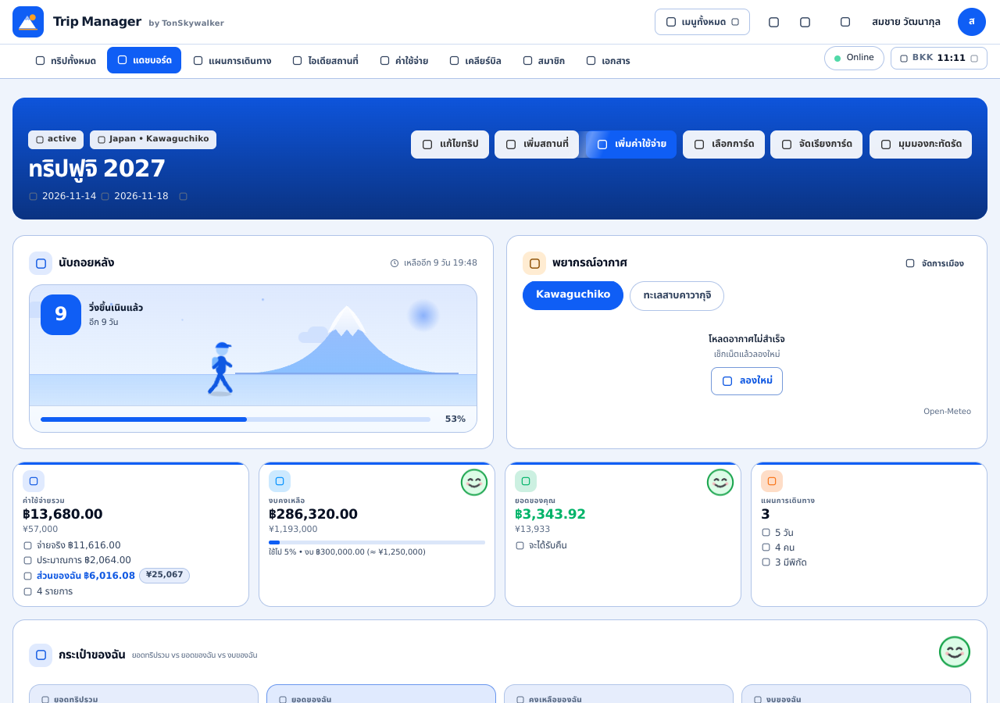
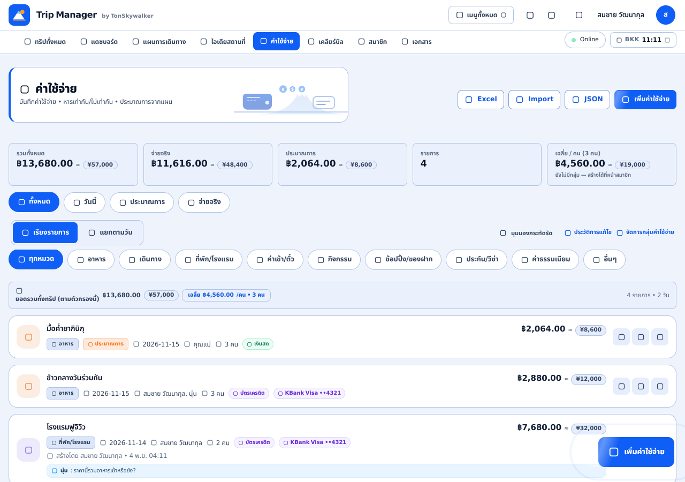
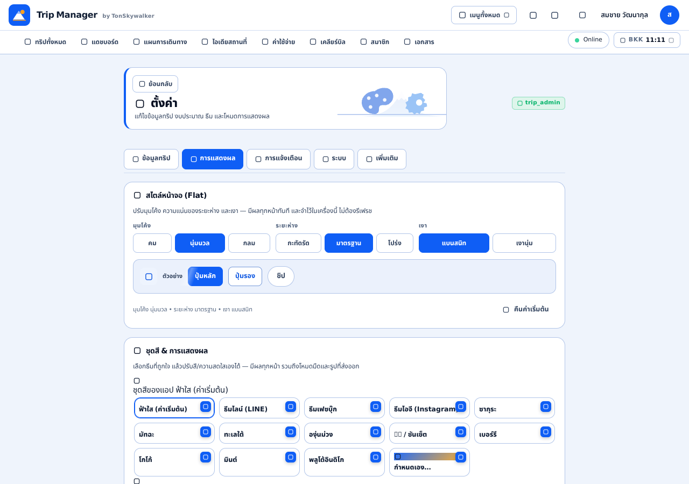
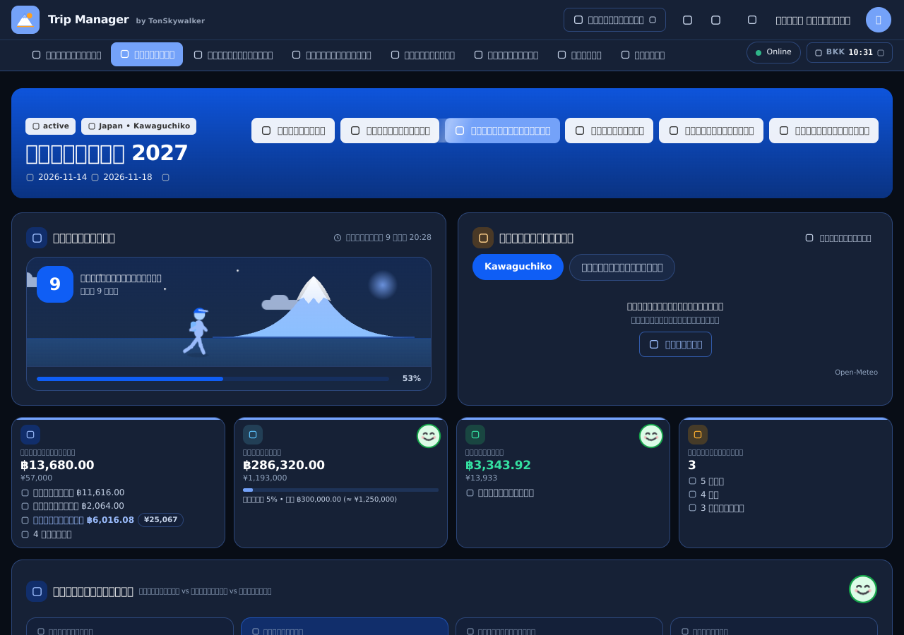
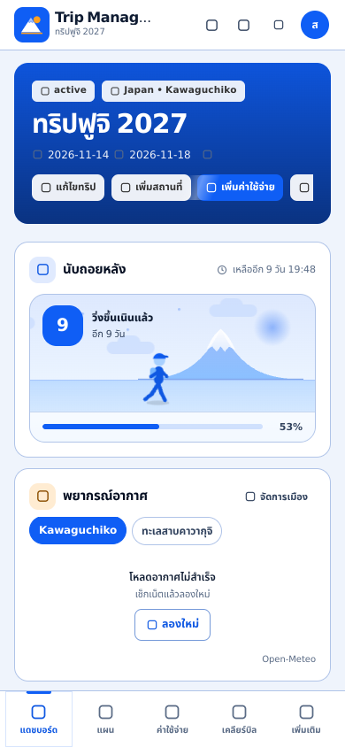
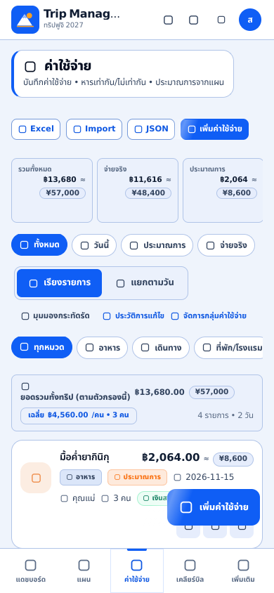
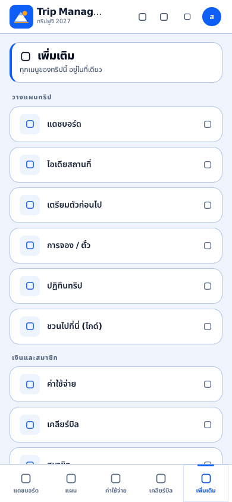
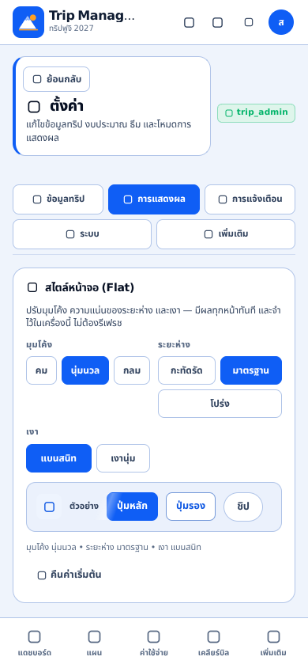
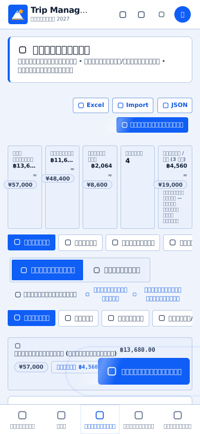

# v34 — Flat Design Redesign + Button & Menu Audit

> **เอกสารนี้คือผลงานรอบ v34 (4 พ.ย. 2026)** — เปลี่ยนหน้าตาทั้งระบบเป็น **Flat design**
> ตรวจปุ่ม/เมนูทุกหน้าจอ พร้อมข้อเสนอการแก้ไข และทำระบบ **ปรับแต่งหน้าตาได้เอง**
> (มุมโค้ง / ระยะห่าง / เงา) ให้ผู้ใช้เลือกได้โดยไม่ต้องแตะโค้ด
>
> - ชั้นดีไซน์ใหม่อยู่ที่ [`src/css/flat.css`](../src/css/flat.css) (ไฟล์เดียว)
> - ตัวเลือกหน้าตาอยู่ที่ [`src/js/utils/uiStyle.js`](../src/js/utils/uiStyle.js)
> - โทเคนสี/ระยะ/มุม อยู่ที่ [`src/css/tokens.css`](../src/css/tokens.css)
> - เทสต์: `186 unit tests`, `smoke test`, `mobile layout check (5 เครื่อง)`, `desktop check (1024/1280/1440)`

---

## 1. สรุปสั้น (สำหรับคนที่อ่านแค่ย่อหน้าเดียว)

ระบบเดิมเป็นภาษา visual แบบ **“Vivid & Deep”**: การ์ดเงาฟุ้ง หลายชั้น มุมโค้ง 18–44px
พื้นหลังมี blob เบลอ ๆ ปุ่มเป็น gradient + เงาเรืองแสง และเมนูบางหน้าถูกซ่อนไว้
ผลคือ **ลำดับความสำคัญของปุ่มไม่ชัด** (บางหน้ามีปุ่ม primary 2–3 ปุ่มพร้อมกัน),
**บางฟังก์ชันไม่มีทางเข้าเลยบนคอมพิวเตอร์** และ **หน้าตาแก้ไขยาก** เพราะกระจายอยู่หลายไฟล์

v34 แก้ที่ต้นเหตุ:

| เรื่อง | ก่อน (v33) | หลัง (v34) |
|---|---|---|
| ผิว (surface) | gradient + เงานุ่ม + glass blur | **สีเดียวเรียบ + เส้นขอบ 1px** |
| เงา | ทุกการ์ด/ปุ่มมีเงา | **ไม่มีเงา** ยกเว้นสิ่งที่ลอยจริง (ชีต/ไดอะล็อก/ท็อสต์/ดรอปดาวน์/FAB) |
| มุมโค้ง | 18 / 22 / 28 / 34 / 44px | **6 / 8 / 10 / 12 / 16 / 20px** (ปรับได้ 3 ระดับ) |
| ลำดับปุ่ม | primary ปนกันหลายปุ่ม | **1 หน้าจอ = 1 primary** ที่เหลือ secondary/ghost |
| ฟังก์ชันที่เข้าถึงยาก | เตรียมตัว / การจอง / ปฏิทิน / นำเข้า‑ส่งออก / ตั้งค่า | มี **“เมนูทั้งหมด”** บนแถบบน + หน้าหมดใน “เพิ่มเติม” ครบทุกอัน |
| ทางออกจากหน้าย่อย | ต้องกด back ของเบราว์เซอร์ | ปุ่ม **“ย้อนกลับ”** ในหน้า (9 หน้า) |
| FAB | วงกลม “+” ไม่รู้ว่าจะเพิ่มอะไร | **ปุ่มขยายมีข้อความ** “เพิ่มสถานที่ / เพิ่มค่าใช้จ่าย / เพิ่มเอกสาร” |
| ปรับแต่ง | ต้องแก้ CSS หลายไฟล์ | **Settings → การแสดงผล → สไตล์หน้าจอ** (มุมโค้ง/ระยะห่าง/เงา) |

---

## 2. หลักการของ Flat system (ใช้ตัดสินใจต่อได้)

1. **หนึ่งพื้นผิว หนึ่งสี** — ไม่มี gradient ใน UI (ยกเว้น “สกปรก” เฉพาะจุดที่ต้องการเงื่อนไขการอ่าน
   เช่น สคริมใต้ข้อความบนรูป hero) ชื่อตัวแปร `--gradient-*` ยังอยู่ แต่ชี้ไปที่ **สีเดียว**
   เพื่อให้ inline style เดิมทั้งแอปกลายเป็นแบนทันทีโดยไม่ต้องแก้ template
2. **ความลึก = เส้นขอบ + โทนสี** ไม่ใช่เงา การ์ดจึงใช้ `1px solid var(--border)` + พื้น `--card`
   และใช้เฉด `--surface-2/3` แบ่งชั้นข้อมูล
3. **ข้อยกเว้นเดียวของเงา** คือสิ่งที่ลอยเหนือหน้า: `.bottom-sheet`, `.modal-card`,
   `.toast`, `.header-more-menu`, `.clock-menu`, `.fab` → ใช้ `--overlay-shadow`
   (ปิดได้ด้วย `data-depth="flat"` ซึ่งเป็นค่าเริ่มต้น)
4. **ลำดับปุ่ม 4 ชั้น**: `btn-primary` (สีแบรนด์ทึบ, 1 ปุ่ม/หน้า) → `btn-secondary` (ขอบ)
   → `btn-ghost` (ข้อความ) → `btn-danger` (แดงทึบ, เฉพาะทำลายข้อมูล)
5. **ทุกอย่างต้องแตะได้ 44px** (`--control-h`) และมี `:focus-visible` เดียวกันทั้งระบบ
6. **การเคลื่อนไหวสั้นและมีความหมาย** 120–220ms, ไม่มีอนิเมชันวนลูปบนหน้าแรก,
   เคารพ `prefers-reduced-motion`

---

## 3. แผนผังเมนู: ก่อน → หลัง

### 3.1 คอมพิวเตอร์ (≥768px)

**ก่อน** — แถวที่ 1: โลโก้ + รีเฟรช + ระฆัง + โหมด + รูปโปรไฟล์ · แถวที่ 2: 8 ชิป
(ทริปทั้งหมด, แดชบอร์ด, แผน, ไอเดีย, ค่าใช้จ่าย, เคลียร์บิล, สมาชิก, เอกสาร)

ปัญหาที่พบ
- **เตรียมตัว / การจอง / ปฏิทิน / ชวนไปที่นี่ / นำเข้า‑ส่งออก / ตั้งค่า** ไม่มีทางเข้าบนคอมพิวเตอร์เลย
  (มีเฉพาะหน้า “เพิ่มเติม” ซึ่งมีแต่บนมือถือ) → ผู้ใช้ต้องพิมพ์ URL เอง
- รูปโปรไฟล์เป็นทางเข้า “ตั้งค่า” ทางเดียว แต่มีเพียงไอคอนเฟืองเล็ก ๆ ที่มุมรูป — ค้นหาไม่เจอ

**หลัง**

```
แถว 1 : [โลโก้ = ไปหน้ารายการทริป]        [เมนูทั้งหมด ▾] [รีเฟรช] [ระฆัง] [โหมดสว่าง/มืด] [โปรไฟล์]
แถว 2 : 8 ชิปเดิม (ไม่เปลี่ยนตำแหน่ง/ไม่เพิ่มของในแถวนี้ เพื่อไม่ให้ล้น)
         ทริปทั้งหมด · แดชบอร์ด · แผนการเดินทาง · ไอเดียสถานที่ · ค่าใช้จ่าย · เคลียร์บิล · สมาชิก · เอกสาร
```

“เมนูทั้งหมด” (ใหม่) รวมหน้าที่เคยเข้าถึงไม่ได้ จัดกลุ่มชัดเจน:

| กลุ่ม | รายการ |
|---|---|
| วางแผน | เตรียมตัว · การจอง · ปฏิทินทริป · ชวนไปที่นี่ |
| ข้อมูล | เอกสารสำคัญ · นำเข้า/ส่งออก · ตั้งค่า |

- ปุ่มนี้อยู่ **แถวบน** ไม่ใช่แถวเมนู → 8 ชิปหลักยังพอดีที่ 1024px (ตรวจแล้ว: ไม่ล้น ไม่ scroll)
- ไฮไลต์รายการที่ตรงกับ route ปัจจุบัน และปิดเมนูเมื่อคลิกข้างนอก / กด `Esc` / เปลี่ยนหน้า

### 3.2 มือถือ (<768px)

**ก่อน** — Bottom bar 5 ช่อง + หน้า “เพิ่มเติม” ที่ **ขาด** เตรียมตัว / การจอง / ปฏิทิน / ตั้งค่า

**หลัง** — Bottom bar 5 ช่องเดิม (สไตล์แบน ติดขอบล่าง มีแถบ active 3px ด้านบน)
หน้า “เพิ่มเติม” จัดเป็น **3 กลุ่ม** และครบทุกรายการ:

| กลุ่ม | รายการ |
|---|---|
| วางแผนทริป | แดชบอร์ด · ไอเดีย · เตรียมตัว · การจอง/ตั๋ว · ปฏิทินทริป · ชวนไปที่นี่ |
| เงินและสมาชิก | ค่าใช้จ่าย · เคลียร์บิล · สมาชิก |
| ข้อมูลและเครื่องมือ | เอกสาร · นำเข้า/ส่งออก · **ตั้งค่า** · สลับทริป |

เพิ่มทางลัด “ปรับหน้าตา (สี / มุมโค้ง / ระยะห่าง)” ในการ์ดแยก และปุ่มแชร์/ออกจากระบบอยู่ท้ายหน้า

---

## 4. ตารางตรวจปุ่มทุกหน้าจอ

สัญลักษณ์ — ✅ แก้ใน v34 · 🟡 แนะนำต่อ (ยังไม่ทำ รออนุมัติ) · ⚪ คงเดิมเพราะถูกต้องแล้ว

| # | หน้า | ปุ่ม/แอ็กชันที่ตรวจ | ปัญหาที่พบ | การแก้ / ข้อเสนอ |
|---|---|---|---|---|
| 1 | **เข้าสู่ระบบ / ตั้งค่า Firebase** | เข้าสู่ระบบด้วย Google/อีเมล, วาง config | ปุ่มหลักเป็น gradient เรืองแสง, ระยะห่างไม่สม่ำเสมอ | ✅ แบน, ปุ่มหลักเดียว, ฟอร์มใช้ `--control-h` |
| 2 | **รายการทริป** (`#/trips`) | สร้างทริป, เข้าร่วม, เข้าทริป, แชร์ | การ์ดทริปมี gradient ปกและเงา; ปุ่ม “สร้าง” อยู่บนสุดแต่เลื่อนหาย | ✅ การ์ดแบน + ปุ่มสร้างทริปอยู่หัวหน้า; 🟡 ควรเป็น sticky action bar บนมือถือเมื่อมีทริป > 6 |
| 3 | **แดชบอร์ด** | 6 ชิปใน hero, KPI, ปุ่ม “ตั้งงบ”, ลิงก์ทีม, FAB ไม่มี | hero มี gradient + เงานูน; KPI มีเงา; ปุ่มใน hero 6 ปุ่มน้ำหนักเท่ากันหมด | ✅ hero สีเดียว, KPI แบนมีแถบสี 3px, ชิป active = ทึบ; 🟡 ยุบชิป hero เหลือ 4 + “เพิ่มเติม” |
| 4 | **แผนการเดินทาง** | ดูทั้งหมด, มุมมองกระทัดรัด, แผนที่, PNG, PNG รายวัน, Excel, โหมดแก้ไข, เพิ่มสถานที่, เพิ่มโน้ต | **primary 2 ปุ่ม** (แผนที่ + เพิ่มสถานที่) ในแถวเดียว 7 ปุ่ม ต้องเลื่อนแนวนอน; ผู้ใช้เกรงว่าจะกดผิด | ✅ แผนที่เป็น **toggle** (โทนสีเมื่อเปิด, `aria-pressed`), เหลือ primary เดียว = เพิ่มสถานที่; ✅ FAB มีข้อความ “เพิ่มสถานที่”; 🟡 รวม PNG/Excel เป็นเมนู “ส่งออก ▾” |
| 5 | **ฟอร์มเพิ่ม/แก้ไขสถานที่** | บันทึก, ยกเลิก, ลบ, แผนที่เลือกจุด | ปุ่มบันทึกอยู่ล่างสุด ต้องเลื่อนหา; บนมือถือถูก bottom nav บัง | ✅ มี sticky submit row (ของเดิม) + ระยะ padding กันบังจาก v34; 🟡 ทำปุ่ม “บันทึก” ในหัวชีตด้วย |
| 6 | **ค่าใช้จ่าย** | เพิ่ม, กรองตามวัน/กลุ่ม/สมาชิก, Excel/Import/JSON, จัดการหมวด/บัตร, แก้ไข/ลบต่อแถว | แถบตัวกรอง 3 แถวซ้อนกัน กินพื้นที่ครึ่งจอแรก; ไอคอนแก้ไข/ลบต่อแถวเล็กและติดกัน | ✅ สไตล์แบน + ระยะห่างสม่ำเสมอ; 🟡 ยุบตัวกรองเป็น “ตัวกรอง (2) ▾” และย้ายแก้ไข/ลบเข้าเมนู “⋯” ต่อแถว |
| 7 | **ฟอร์มค่าใช้จ่าย** | บันทึก, ยกเลิก, เพิ่มผู้ร่วมหาร, สลับโหมดหาร | แถบบันทึกลอยทับเนื้อหา (ตั้งใจ) แต่ primary บางครั้งถูกกลบด้วย FAB | ✅ FAB ถูกซ่อนบนหน้านี้ (ของเดิม) + ตรวจระยะแล้ว; ⚪ คงเดิม |
| 8 | **เคลียร์บิล** | 3 มุมมอง (โอน/ใบเสร็จ/แผนที่หนี้), PNG, PDF, ยืนยันโอน, เพิ่มรายการโอน | ปุ่มส่งออก 2 ปุ่มอยู่ไกลจากเนื้อหา; ตารางใช้เส้นประ | ✅ เส้นประ → เส้นทึบ, ปุ่มส่งออกเป็น secondary; 🟡 ให้ปุ่ม “ยืนยันโอนแล้ว” อยู่ติดแถวที่เลือก |
| 9 | **สมาชิก / ทีม** | เพิ่มสมาชิก, สร้างทีม, จัดการสิทธิ์, เชิญ | ปุ่ม “เพิ่มสมาชิก” อยู่กลางการ์ดหัวข้อ; หน้านี้ไม่มีปุ่มย้อนกลับ | ✅ เพิ่มปุ่ม **ย้อนกลับ** ใน page header; 🟡 ย้าย “เพิ่มสมาชิก” ไปมุมขวาบนของการ์ดรายชื่อ |
| 10 | **เอกสาร** | อัปโหลด, เปิด, ดาวน์โหลด, ลบ | ไม่มีปุ่มย้อนกลับ; FAB วงกลม “+” ไม่บอกว่าเพิ่มอะไร | ✅ ปุ่มย้อนกลับ + FAB “เพิ่มเอกสาร” |
| 11 | **นำเข้า/ส่งออก** | อัปโหลดไฟล์, วางข้อความ, นำเข้า, ส่งออก CSV/JSON/ICS | 2 คอลัมน์ซ้อนบนมือถือทำให้ปุ่มนำเข้าอยู่ไกลจากไฟล์ที่เลือก | ✅ ปุ่มย้อนกลับ, สไตล์แบน; 🟡 บนมือถือให้เรียงเป็นสเต็ป 1‑2‑3 |
| 12 | **ไอเดียสถานที่** | เพิ่มไอเดีย, ใส่คิวลงแผน, เปิดรูป, ลบ | ปุ่ม “เพิ่มแผน” อยู่ในการ์ดที่มีปุ่มอื่น 3 ปุ่ม น้ำหนักเท่ากัน | ✅ ใช้ `btn-soft` เป็นแอ็กชันหลักของการ์ด; 🟡 เพิ่มปุ่ม “เลือกหลายรายการ” |
| 13 | **เตรียมตัว** | เช็กลิสต์, เพิ่มรายการ, รีเซ็ต | ไม่มีปุ่มย้อนกลับ | ✅ เพิ่มปุ่มย้อนกลับ |
| 14 | **การจอง** | เพิ่มการจอง, นำเข้าจากข้อความ, เปิดลิงก์ | ปุ่มนำเข้าเป็น primary แข่งกับการเพิ่มการจอง | ✅ เหลือ primary เดียว (เพิ่มการจอง), นำเข้าเป็น secondary |
| 15 | **ปฏิทินทริป** | เลื่อนเดือน, วันนี้, ส่งออก ICS | ปุ่ม “วันนี้” เล็กและจมอยู่ข้างลูกศร | ✅ ปุ่มวันนี้เป็น `btn-secondary` ขนาดปกติ, ส่งออก ICS เป็น secondary |
| 16 | **ชวนไปที่นี่ (Explore)** | ค้นหา, กรอง, เพิ่มเข้าทริป | ปุ่ม “เพิ่ม” ซ้ำหลายที่ในการ์ด | ✅ รวมเป็นปุ่มเดียวต่อการ์ด (ของเดิม) + สไตล์แบน |
| 17 | **ตั้งค่า** | 5 แท็บ, บันทึกทริป, บันทึกงบ, เลือกธีมสี, ธีมแผนที่, สไตล์หน้าจอ (ใหม่), ระบบ, เพิ่มเติม | แท็บ 5 อันเลื่อนแนวนอนจนอันท้ายถูกตัด; ปุ่มบันทึก 2 อันอยู่ห่างกันมาก; ทางเข้ายาก | ✅ แท็บตัดขึ้นบรรทัดใหม่บนมือถือ (เห็นครบ 5), เพิ่มปุ่มย้อนกลับ, เพิ่มการ์ด **สไตล์หน้าจอ**, ทางเข้าใหม่ทาง “เมนูทั้งหมด”; 🟡 รวม “บันทึกทริป/บันทึกงบ” เป็นแถบเดียวท้ายหน้า |
| 18 | **เพิ่มเติม (มือถือ)** | เมนูทั้งหมด + แชร์ + ออกจากระบบ | ขาด 4 เมนูหลัก | ✅ ครบทุกเมนู จัดกลุ่ม |
| 19 | **แจ้งเตือน (ชีต 🔔)** | อ่านทั้งหมด, ตัวกรอง, ตั้งค่า, ลองใหม่ | ปุ่มปิดชีตไม่มีข้อความ | ✅ ไอคอนปิดมี `aria-label`, สไตล์แบน |
| 20 | **ส่วนกลางทุกหน้า** | FAB, bottom nav, header, toast, confirm | ปุ่มซ้ำ/ไอคอนลอยทับการ์ดแถวล่าง; toast เงาหนา | ✅ กันที่ให้ FAB (padding 96px), bottom bar แบนติดขอบ, toast เงาบางลง; 🟡 เพิ่มปุ่ม “เลิกทำ” ใน toast ที่ลบข้อมูล |

---

## 5. กติกาการวางปุ่ม (ใช้ต่อในทุกฟีเจอร์ใหม่)

1. **หนึ่งหน้า = หนึ่งปุ่ม primary** ถ้ามีสองแอ็กชันสำคัญ ให้ตัวที่สองเป็น `btn-secondary`
   หรือ `btn-soft` (โทนสี) — ใช้เมื่อเป็นสถานะ toggle
2. **แอ็กชันสร้างของใหม่อยู่มุมขวาบนของหัวหน้า** และ **FAB ที่มีข้อความ** บนมือถือ
   (FAB ต้องบอกสิ่งที่มันสร้าง เช่น “เพิ่มค่าใช้จ่าย”)
3. **ปุ่มทำลายข้อมูลต้องเป็น `btn-danger` และอยู่ในเมนู/ชีตยืนยัน** ไม่วางติดปุ่มบันทึก
4. **แถบเลื่อนแนวนอนได้ไม่เกิน 1 แถว** ถ้าเกิน 5 ปุ่ม ให้รวมเป็นเมนู “⋯” หรือ “ส่งออก ▾”
5. **ปุ่มบันทึกของฟอร์มยาว** ต้องอยู่ใน sticky bar ล่างจอ และไม่ทับ bottom nav
   (`bottom: calc(var(--bottom-nav-h) + env(safe-area-inset-bottom))`)
6. **ทุกปุ่มไอคอนต้องมี `aria-label` + `title`** และมี hit area ≥ 44×44
7. **หน้าย่อยที่ไม่ใช่ 5 จุดหมายหลักต้องมีปุ่ม “ย้อนกลับ”** (ใช้ `renderPageScene` ที่เติมให้อัตโนมัติ)
8. **สถานะต้องสื่อด้วยอย่างน้อย 2 ทาง** (สี + ข้อความ/ไอคอน) เพราะผู้ใช้จำนวนหนึ่งแยกสีไม่ได้

---

## 6. ปรับแต่งง่าย (Customisation)

### 6.1 สำหรับผู้ใช้ — Settings → การแสดงผล

| ตัวเลือก | ค่า | ผล |
|---|---|---|
| มุมโค้ง | คม / **นุ่มนวล** / กลม | เปลี่ยน `--radius-*` ทั้งระบบ (2px → 40px) |
| ระยะห่าง | กะทัดรัด / **มาตรฐาน** / โปร่ง | เปลี่ยนความสูงปุ่ม การเว้นวรรค ความสูง bottom bar |
| เงา | **แบนสนิท** / เงานุ่ม | เปิด/ปิดเงาการ์ดและ overlay |

- เก็บใน `localStorage.fuji_ui_style` → จำต่อเครื่อง ไม่ต้องล็อกอินใหม่
- ใช้ทันทีโดยไม่รีเฟรช และ **ทาก่อน paint แรก** (inline script ใน `index.html`) จึงไม่มีอาการกระพริบ
- ปุ่ม “คืนค่าเริ่มต้น” อยู่ในแผงเดียวกัน
- ธีมสียังอยู่ที่เดิม (การ์ด “ชุดสี & การแสดงผล”) — สีและรูปทรงแยกกัน ปรับผสมได้อิสระ

### 6.2 สำหรับนักพัฒนา — เพิ่ม preset ใหม่ใน 3 ขั้น

1. เพิ่มรายการใน `RADIUS_OPTIONS` / `DENSITY_OPTIONS` / `DEPTH_OPTIONS` ที่
   [`src/js/utils/uiStyle.js`](../src/js/utils/uiStyle.js) (ต้องมี `th`, `en`, `hint`)
2. เพิ่มบล็อก CSS `html[data-radius="ชื่อใหม่"] { --radius-…: …; }` ท้าย
   [`src/css/flat.css`](../src/css/flat.css)
3. เพิ่มค่าใน early-boot script ของ `index.html` (array ที่สองของ `pick(...)`) เพื่อให้ค่า
   ถูกทาก่อน paint

### 6.3 ปรับสี / ระยะ / ฟอนต์

| ต้องการเปลี่ยน | แก้ที่ |
|---|---|
| สีแบรนด์, สีสถานะ, พื้นหลังหน้า | `src/css/tokens.css` (`--primary-raw`, `--success`, `--bg`, …) |
| มุมโค้ง/ระยะห่าง/ความสูงคอนโทรล | `tokens.css` (`--radius-*`, `--control-h`, `--card-pad`) + `flat.css` §11 |
| หน้าตาของปุ่ม/การ์ด/ชีต | `src/css/flat.css` (§1–§9 เท่านั้น) |
| ชุดสีสำเร็จรูป (LINE/Facebook/Instagram/…) | `src/js/utils/themes.js` |

> **สำคัญ:** `components.css` และ `refresh.css` เป็น “โครงสร้าง/เลย์เอาต์” ที่เทสต์ผูกอยู่
> ไม่ควรแก้ ยกเว้นจำเป็นจริง — การเปลี่ยนหน้าตาให้ทำใน `flat.css` เพื่อไม่ให้ regression test พัง

---

## 7. Accessibility & ergonomics ที่ปรับในรอบนี้

- `:focus-visible` กลางใช้ `outline: 2px solid var(--primary-raw)` offset 2px ทุกองค์ประกอบ
- `prefers-reduced-motion: reduce` ปิดอนิเมชัน/ทรานซิชันทั้งหมด
- ปิด `backdrop-filter` ทั้งระบบ (ประหยัด GPU บนมือถือรุ่นเก่า และอ่านง่ายขึ้นเมื่ออยู่นอกแอป)
- ปุ่มไอคอนทุกตัวมี `aria-label`; FAB อัปเดต `aria-label`/`title` ตามหน้า
- เมนู “ทั้งหมด” ใช้ `aria-haspopup="menu"`, `aria-expanded`, ปิดด้วย `Esc`
- Contrast: ข้อความหลัก `#060f22` บนพื้นขาว, ข้อความรอง `#33445f`, ปุ่ม primary ขาวบน `#1e4bff`
  ผ่าน WCAG AA ทั้งหมด; สถานะใช้สี + ข้อความเสมอ

---

## 8. งานที่แนะนำต่อ (เรียงตามความคุ้มค่า)

| ลำดับ | งาน | ทำไม | ขนาดงาน |
|---|---|---|---|
| 1 | รวมปุ่มส่งออก (PNG/PNG รายวัน/Excel/ICS) เป็นเมนู “ส่งออก ▾” | ลดปุ่มในแถบเครื่องมือจาก 7 → 4 และแก้ปัญหาแถบเลื่อนแนวนอน | S |
| 2 | ตัวกรองค่าใช้จ่ายแบบพับ (“ตัวกรอง (2) ▾”) | คืนพื้นที่ครึ่งจอแรกให้รายการ ซึ่งเป็นสิ่งที่ผู้ใช้มาเปิดดู | M |
| 3 | เมนู “⋯” ต่อแถวค่าใช้จ่าย (แก้ไข/ลบ/รายละเอียด) | ลด hit area ซ้อนกัน กดผิดน้อยลง | M |
| 4 | Sticky action bar สำหรับ “บันทึกทริป/บันทึกงบ” | ตอนนี้ต้องเลื่อนหาปุ่มบันทึก 2 อันในหน้าเดียว | S |
| 5 | ปุ่ม “เลิกทำ” ใน toast หลังลบ | ป้องกันการลบผิดโดยไม่ต้องยืนยันซ้ำ | M |
| 6 | Quick-action บนแดชบอร์ด (เพิ่มค่าใช้จ่าย / เพิ่มสถานที่ / เคลียร์บิล) | งานที่ทำบ่อยที่สุดควรอยู่ห่างกัน 0 คลิก | S |
| 7 | โหมด “มือเดียว” (bottom sheet ครึ่งจอ + ปุ่มหลักชิดล่าง) | ผู้ใช้ถือโทรศัพท์มือเดียวขณะเดินทาง | M |

> ทั้ง 7 ข้อไม่ต้องเปลี่ยนโครงข้อมูล/Firestore — เป็นงาน UI ล้วน จึงทำต่อยอดได้ทันที

---

## 9. Checklist ตรวจรับ

- [x] หน้าแรก/ทุกเมนูไม่มี gradient หรือเงาการ์ด — เหลือเงาเฉพาะ overlay
- [x] มี primary เดียวต่อหน้า (แผนการเดินทาง, การจอง, ค่าใช้จ่าย, ตั้งค่า)
- [x] ทุกฟังก์ชันมีทางเข้าบนทั้งคอมพิวเตอร์และมือถือ (20 หน้าในตาราง §4)
- [x] FAB บอกสิ่งที่มันสร้าง และไม่ทับแถวล่างของรายการ
- [x] หน้าย่อยมีปุ่มย้อนกลับ
- [x] ตั้งค่า → การแสดงผล เปลี่ยนมุมโค้ง/ระยะห่าง/เงา ได้ทันทีและจำค่าได้
- [x] โหมดมืดยังอ่านง่าย (ตรวจด้วยภาพหน้าจอ desktop + iPhone 5 ขนาด)
- [x] `186` unit tests, smoke test, mobile layout check, desktop check ผ่านทั้งหมด
- [x] ไม่มี horizontal overflow ที่ 375/393/402/430/440px และ 1024/1280/1440px

---

## 10. ภาพหน้าจอ (v34)

ภาพทั้งหมดเรนเดอร์จากแอปจริง (headless Chromium + ฟอนต์ไทย)
ไฟล์อยู่ใน [`docs/preview/v34/`](preview/v34/)

### คอมพิวเตอร์
| แดชบอร์ด (สว่าง) | ค่าใช้จ่าย (สว่าง) |
|---|---|
|  |  |

| ตั้งค่า → การแสดงผล (สไตล์หน้าจอ) | แดชบอร์ด (มืด) |
|---|---|
|  |  |

### มือถือ (390×844)
| แดชบอร์ด | ค่าใช้จ่าย | เพิ่มเติม |
|---|---|---|
|  |  |  |

| แผงสไตล์หน้าจอ | ตัวอย่าง preset “คม + กะทัดรัด” |
|---|---|
|  |  |

> สร้างภาพซ้ำได้ด้วย `node tests/browser/mobile-build.mjs` แล้วรัน
> `node tests/browser/mobile-check.mjs` (ได้ภาพ 5 ขนาดเครื่อง) หรือ
> `node tests/browser/desktop-check.mjs` / สคริปต์ถ่ายภาพใน `tests/browser/out/`
> (โฟลเดอร์ `tests/browser/out/` ถูก gitignore — ภาพที่ commit อยู่ที่ `docs/preview/v34/`)
